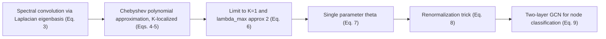

# Semi-Supervised Classification with Graph Convolutional Networks

> [!summary] One-sentence positioning
> Kipf and Welling derive a simple layer-wise graph convolution rule from a first-order spectral approximation and use a two-layer GCN for semi-supervised node classification. It beats baselines on Citeseer, Cora, Pubmed and NELL with linear edge-count complexity. (PDF pp. 1–3, 7)

*Legend: **[Analytical inference]** (分析性归纳) marks my own judgement, not an author claim. Page numbers are PDF page numbers (they equal printed page numbers). Items I could not confirm are written as "not stated" or null.*

---

## 1. Basic information

| Field | Content |
|---|---|
| Authors | Thomas N. Kipf, Max Welling (University of Amsterdam; Welling also Canadian Institute for Advanced Research) (PDF p. 1) |
| Year | 2017 (arXiv v4, 22 Feb 2017) (PDF p. 1) |
| Source | Conference paper at ICLR 2017; arXiv:1609.02907v4 [cs.LG]. Code: https://github.com/tkipf/gcn (PDF pp. 1, 4) |
| DOI | Not stated (null) |
| Research domains | Graph neural networks; graph-based semi-supervised learning |
| Research type | Method paper with empirical evaluation |
| Research object | Classifying nodes in a graph when labels exist for only a small subset of nodes |
| Study area | No geographic area (citation networks, a knowledge graph, random graphs) |
| Spatial scale | Not applicable |
| Time range | Not applicable (static graph datasets; dataset dates not stated) |

---

## 2. Background and research problem

### 2.1 Research background
- The task is classifying nodes (such as documents) in a graph (such as a citation network) where labels are available for only a small subset of nodes (PDF p. 1).
- Prior work frames this as graph-based semi-supervised learning with explicit graph-based regularisation, e.g., a graph Laplacian term in the loss: L = L0 + λ L_reg (Eq. 1) (PDF p. 1).
- Related approaches also include skip-gram-style graph embeddings (DeepWalk, LINE, node2vec, Planetoid) and earlier neural networks on graphs (PDF pp. 4–5).

### 2.2 Literature gap (as stated by the authors)
1. Laplacian-regularisation methods assume that connected nodes tend to share the same label, which "might restrict modeling capacity" since edges can carry other information (PDF p. 1).
2. Skip-gram embedding methods need a multi-step pipeline (random-walk generation, then semi-supervised training), with each step optimised separately (PDF p. 5).
3. Earlier graph neural networks have scaling or design problems: degree-specific weight matrices that do not scale to wide degree distributions (Duvenaud et al., 2015), O(N²) complexity (Atwood & Towsley, 2016), or a node-ordering requirement (Niepert et al., 2016) (PDF p. 5).
4. Spectral approaches (Bruna et al., 2014; Defferrard et al., 2016) were not examined for transductive node classification on larger networks; the authors introduce simplifications for scalability and accuracy (PDF p. 5).

### 2.3 Research objectives and questions
- **Objective:** a scalable semi-supervised node-classification model that encodes the graph structure directly with a neural network f(X, A), avoiding explicit regularisation in the loss (PDF p. 1).
- **Contributions (stated):** (1) a simple, well-behaved layer-wise propagation rule motivated by a first-order approximation of spectral graph convolutions; (2) a demonstration of fast, scalable semi-supervised node classification with it (PDF p. 1).
- **Hypotheses:** the paper states no formal hypotheses ("原文未提出明确假设"). It states an intuitive expectation that the layer-wise linear formulation can alleviate overfitting on local neighbourhood structures for graphs with wide degree distributions (PDF p. 3).

---

## 3. Theory and conceptual framework

### 3.1 Core concepts

| Concept | Definition or use in the paper | Operationalisation | Obsidian link |
|---|---|---|---|
| Graph Convolutional Network (GCN) | Multi-layer network with the propagation rule H^(l+1) = σ(D̃^(-1/2) Ã D̃^(-1/2) H^(l) W^(l)) (PDF p. 2) | Two-layer GCN with softmax output (Eq. 9) (PDF p. 3) | [[Graph_Convolutional_Network]] |
| Spectral graph convolution | Multiplication of a node signal x with a filter g_θ in the Fourier domain of the graph Laplacian (Eq. 3) (PDF p. 2) | Approximated by Chebyshev polynomials, then reduced to K = 1 (PDF pp. 2–3) | [[Spectral_Graph_Convolution]] |
| Layer-wise propagation | Each layer aggregates features of neighbouring nodes; k stacked layers convolve the k-th-order neighbourhood (PDF p. 3) | Sparse-dense matrix products (PDF p. 4) | [[Layer_Wise_Propagation]] |
| Node classification (semi-supervised) | Classifying nodes with labels available for few nodes (PDF p. 1) | Cross-entropy over labelled nodes only (Eq. 10) (PDF p. 4) | [[Node_Classification]] |
| Graph Laplacian regularisation | Smoothing label information over the graph via a loss term, assuming connected nodes share labels (PDF p. 1) | Used as a contrast (baselines LP, ManiReg, SemiEmb) (PDF pp. 1, 6) | [[Graph_Laplacian_Regularization]] |
| Renormalization trick | I_N + D^(-1/2) A D^(-1/2) → D̃^(-1/2) à D̃^(-1/2) with à = A + I_N, to avoid numerical instability (PDF p. 3) | Pre-computed  (PDF p. 3) | [[Renormalization_Trick]] |

### 3.2 Theoretical foundations
- **Spectral graph theory and graph signal processing:** convolution defined in the Fourier domain of the normalised Laplacian; Chebyshev approximation from Hammond et al. (2011) → [[Hammond_2011_Wavelets_on_Graphs]] (PDF p. 2).
- **Spectral CNNs on graphs:** the model builds on Bruna et al. (2014) and Defferrard et al. (2016), with simplifications → [[Bruna_2014_Spectral_Networks]], [[Defferrard_2016_Fast_Localized_Spectral_Filtering]] (PDF pp. 2, 5).
- **Weisfeiler–Lehman (WL-1) algorithm:** the GCN is interpreted as a differentiable, parameterised generalisation of WL-1 (Appendix A) → [[Weisfeiler_Lehman_Algorithm]] (PDF p. 11).

### 3.3 Concept relationships
The model is derived through a chain of approximations (PDF pp. 2–3):

---

## 4. Data and methods

### 4.1 Research design
Quantitative model-development and benchmarking study: derivation of a propagation rule, comparison with baselines on four node-classification datasets, an ablation of propagation models, a run-time analysis on random graphs, plus appendix experiments on depth and on embeddings (PDF pp. 5–8, 11–14).

### 4.2 Data

| Data or sample | Source | Quantity and time | Spatial granularity | Use | Limitation |
|---|---|---|---|---|---|
| Citeseer | Citation network (Sen et al., 2008); setup follows Yang et al. (2016) (PDF p. 5) | 3,327 nodes, 4,732 edges, 6 classes, 3,703 features, label rate 0.036 (PDF p. 5) | Not applicable | Node classification | Citation links treated as undirected edges with a binary symmetric adjacency (PDF p. 6) |
| Cora | Same | 2,708 nodes, 5,429 edges, 7 classes, 1,433 features, label rate 0.052 (PDF p. 5) | Not applicable | Node classification; hyperparameter tuning (PDF p. 6) | Same |
| Pubmed | Same | 19,717 nodes, 44,338 edges, 3 classes, 500 features, label rate 0.003 (PDF p. 5) | Not applicable | Node classification | Same |
| NELL | Knowledge graph (Carlson et al., 2010; Yang et al., 2016) (PDF p. 5) | 65,755 nodes, 266,144 edges, 210 classes, 5,414 features, label rate 0.001; 55,864 relation nodes and 9,891 entity nodes; features extended to 61,278-dim sparse vectors with one-hot relation nodes (PDF pp. 5–6) | Not applicable | Entity classification with one labelled example per class | Directed labelled edges converted to an undirected bipartite graph; adjacency set to 1 if one or more edges exist (PDF p. 6) |
| Random graphs | Simulated by the authors (PDF p. 6) | N nodes, 2N edges assigned uniformly at random; X = I_N; dummy labels (PDF p. 6) | Not applicable | Training time per epoch | Featureless; timing only |
| Zachary's karate club | Zachary (1977) (PDF p. 11) | 34 nodes, 154 edges as stated, 4 classes from modularity clustering (PDF p. 11) | Not applicable | Embedding illustrations (Appendix A) | Illustrative only |

### 4.3 Method flow
1. **Pre-processing:** Input: adjacency A. Compute à = A + I_N, D̃, and  = D̃^(-1/2) à D̃^(-1/2) once (PDF p. 3).
2. **Forward pass:** Input: node features X and Â. Two layers: ReLU(Â X W^(0)) then softmax(Â · W^(1)) (Eq. 9) (PDF p. 3).
3. **Loss:** Cross-entropy over labelled nodes only (Eq. 10) (PDF p. 4).
4. **Training:** Full-batch gradient descent with dropout; Adam with learning rate 0.01, at most 200 epochs, early stopping with a window of 10 on validation loss; Glorot initialisation and row-normalised features (PDF pp. 4, 6).
5. **Hyperparameter selection:** Optimised on Cora only, with a 500-node validation set, then reused for Citeseer and Pubmed (PDF p. 6).
6. **Evaluation:** Test on 1,000 labelled nodes using the Yang et al. (2016) splits; report mean accuracy over 100 random weight initialisations; also 10 random splits (PDF pp. 6–7).
7. **Ablation and scalability checks:** compare propagation variants (Table 3), time per epoch on random graphs (Fig. 2), depth up to 10 layers with and without residual connections (Appendix B) (PDF pp. 7–8, 14).

### 4.4 Models, indicators and variables

| Name | Type | Definition or calculation | Role in study |
|---|---|---|---|
| Classification accuracy | Indicator | Percent correct on 1,000 test nodes (PDF p. 7) | Main performance measure |
| Wall-clock training time | Indicator | Seconds until convergence, including validation evaluation (PDF p. 7) | Efficiency comparison with Planetoid |
| Time per epoch | Indicator | Mean over 100 epochs, forward, loss and backward pass (PDF p. 8) | Scalability on random graphs, GPU vs CPU |
| Number of layers | Independent variable | 1–10 layers (PDF p. 14) | Depth experiment |
| Propagation model | Independent variable | Chebyshev (K = 2, 3), 1st-order, single parameter, renormalisation trick, 1st-order term only, MLP (PDF p. 7) | Ablation |
| Hyperparameters | Model parameters | Citeseer/Cora/Pubmed: dropout 0.5, L2 5·10⁻⁴ (first layer), 16 hidden units; NELL: dropout 0.1, L2 1·10⁻⁵, 64 hidden units (PDF p. 7) | Training configuration |

**Key equations (numbering as in the paper):**

Laplacian regularisation (PDF p. 1):

$$\mathcal{L}=\mathcal{L}_0+\lambda\mathcal{L}_{\text{reg}},\quad \mathcal{L}_{\text{reg}}=\sum_{i,j}A_{ij}\lVert f(X_i)-f(X_j)\rVert^2=f(X)^{\top}\Delta f(X)\tag{1}$$

*L₀* supervised loss on labelled nodes; *f(·)* differentiable function; *λ* weighting factor; *X* node feature matrix; *Δ = D − A* unnormalised graph Laplacian; *A* adjacency; *D* degree matrix.

GCN propagation rule (PDF p. 2):

$$H^{(l+1)}=\sigma\!\left(\tilde D^{-\frac12}\tilde A\tilde D^{-\frac12}H^{(l)}W^{(l)}\right)\tag{2}$$

*Ã = A + I_N*; *D̃_ii = Σ_j Ã_ij*; *W^(l)* trainable layer weights; *σ* activation (e.g., ReLU); *H^(0) = X*.

Spectral convolution (PDF p. 2):

$$g_\theta\star x=Ug_\theta U^{\top}x\tag{3}$$

*U* eigenvectors of the normalised Laplacian *L = I_N − D^(−1/2) A D^(−1/2) = UΛU^T*; *g_θ = diag(θ)*.

Chebyshev approximation (PDF p. 2):

$$g_{\theta'}(\Lambda)\approx\sum_{k=0}^{K}\theta'_kT_k(\tilde\Lambda)\tag{4}$$
$$g_{\theta'}\star x\approx\sum_{k=0}^{K}\theta'_kT_k(\tilde L)x\tag{5}$$

*Λ̃ = (2/λ_max)Λ − I_N*; *L̃ = (2/λ_max)L − I_N*; *T_k(x) = 2xT_{k−1}(x) − T_{k−2}(x)*, *T₀ = 1*, *T₁ = x*; *θ'* Chebyshev coefficients. The filter is K-localized and evaluating Eq. 5 costs O(|E|).

First-order and single-parameter simplifications with λ_max ≈ 2 (PDF p. 3):

$$g_{\theta'}\star x\approx\theta'_0x+\theta'_1(L-I_N)x=\theta'_0x-\theta'_1D^{-\frac12}AD^{-\frac12}x\tag{6}$$
$$g_\theta\star x\approx\theta\left(I_N+D^{-\frac12}AD^{-\frac12}\right)x,\quad\theta=\theta'_0=-\theta'_1\tag{7}$$

Generalised signal with renormalisation (PDF p. 3):

$$Z=\tilde D^{-\frac12}\tilde A\tilde D^{-\frac12}X\Theta\tag{8}$$

*X ∈ R^{N×C}* (C input channels); *Θ ∈ R^{C×F}* filter parameters; *Z ∈ R^{N×F}*; complexity O(|E|FC).

Two-layer model and loss (PDF pp. 3–4):

$$Z=\operatorname{softmax}\!\left(\hat A\,\operatorname{ReLU}\!\left(\hat AXW^{(0)}\right)W^{(1)}\right),\quad \hat A=\tilde D^{-\frac12}\tilde A\tilde D^{-\frac12}\tag{9}$$
$$\mathcal{L}=-\sum_{l\in\mathcal{Y}_L}\sum_{f=1}^{F}Y_{lf}\ln Z_{lf}\tag{10}$$

*W^(0) ∈ R^{C×H}*, *W^(1) ∈ R^{H×F}*; softmax applied row-wise; *Y_L* indices of labelled nodes; *Y_lf* label indicator. Complexity of Eq. 9 is O(|E|CHF).

Trade-off parameter (PDF p. 8):

$$\tilde A=A+\lambda I_N\tag{11}$$

*λ* trades off self-connections vs neighbour edges and could be learned (a suggestion, not tested).

WL-1 correspondence (PDF p. 11):

$$h_i^{(l+1)}=\sigma\!\left(\sum_{j\in\mathcal N_i}\frac{1}{c_{ij}}h_j^{(l)}W^{(l)}\right),\quad c_{ij}=\sqrt{d_id_j}\ \text{recovers Eq. 2}\tag{12}$$

Residual variant used in Appendix B (PDF p. 14):

$$H^{(l+1)}=\sigma\!\left(\tilde D^{-\frac12}\tilde A\tilde D^{-\frac12}H^{(l)}W^{(l)}\right)+H^{(l)}\tag{14}$$

Eq. 13 (untrained 3-layer GCN with tanh used for embeddings) is described on PDF p. 11.

### 4.5 Method evaluation
- **Soundness:**
  - The derivation reduces spectral filtering to a one-parameter, first-order rule with an explicit renormalisation to avoid exploding or vanishing gradients (PDF p. 3).
  - The ablation (Table 3) tests the intermediate rules directly (PDF p. 7).
  - The Weisfeiler–Lehman view provides an independent interpretation (PDF p. 11).
- **Improvement over prior methods (as claimed):** linear complexity in the number of edges, a single weight matrix per layer and degree normalisation, and a single end-to-end model (vs multi-step pipelines) (PDF pp. 1, 5, 8).
- **Bias and validity risks [Analytical inference]:**
  - Baseline numbers (except ICA) are taken from the Planetoid paper, while GCN and Planetoid timings come from the authors' runs on their hardware (PDF p. 7).
  - GCN's fixed-split result is a mean over 100 initialisations with no variance reported; the random-split results are lower (e.g., NELL 58.4 ± 1.7 vs 66.0 on the fixed split) and are not compared with baselines on the same random splits (PDF p. 7).
  - "Significant margin" is stated without statistical tests.
  - Hyperparameters were tuned on Cora and reused for the other citation datasets (PDF p. 6), so Cora results may be somewhat optimistic relative to Citeseer/Pubmed.
  - The four datasets are citation and knowledge-graph benchmarks where, as the authors' own motivation suggests, neighbouring nodes often share labels; behaviour on graphs where edges do not encode similarity is not tested.
  - The claim that the layer-wise linear formulation alleviates overfitting on local neighbourhood structure (PDF p. 3) is stated as an intuitive expectation and is not tested directly.
- **Missing for reproducibility [Analytical inference]:** code is available (PDF p. 4); the paper does not report hyperparameter search ranges, the number of hidden layers' tuning grid, or the exact seeds; the position of the out-of-memory case in Fig. 2 is shown only graphically.

---

## 5. Main results

### 5.1 Core findings

1. **GCN outperforms all compared baselines on four node-classification benchmarks.**
   - *Content:* GCN accuracy 70.3 (Citeseer), 81.5 (Cora), 79.0 (Pubmed), 66.0 (NELL), versus the best baseline listed (Planetoid* 64.7 / 75.7 / 77.2 / 61.9, ICA 69.1 on Citeseer).
   - *Evidence:* Table 2 (PDF p. 7).
   - *Authors' interpretation:* Laplacian-regularisation methods are limited by the assumption that edges encode similarity; skip-gram methods by a hard-to-optimise multi-step pipeline; feature propagation at every layer beats label-only aggregation as in ICA (PDF p. 8).
2. **The renormalised propagation rule is the best among tested propagation variants on all three citation datasets.**
   - *Content:* Renormalisation trick 70.3 / 81.5 / 79.0; Chebyshev K = 3: 69.8 / 79.5 / 74.4; K = 2: 69.6 / 81.2 / 73.8; MLP without graph: 46.5 / 55.1 / 71.4.
   - *Evidence:* Table 3 (PDF p. 7).
   - *Interpretation:* it offers fewer parameters and operations plus better predictive performance than the naïve first-order model and higher-order Chebyshev models (PDF p. 8).
3. **Efficiency.**
   - *Content:* Training time to convergence 7 s (Citeseer), 4 s (Cora), 38 s (Pubmed), 48 s (NELL) for GCN, versus 26 s, 13 s, 25 s, 185 s for Planetoid*; complexity is linear in the number of edges; time per epoch is measured on random graphs on GPU and CPU.
   - *Evidence:* Table 2 times, Fig. 2, Eq. 9 complexity (PDF pp. 4, 7–8).
   - *Interpretation:* comparable or better efficiency than related methods; CPU training remains viable when graphs do not fit on the GPU (PDF p. 8).
4. **Depth.**
   - *Content:* Best results come from 2- or 3-layer models; beyond about 7 layers training without residual connections becomes difficult; residual connections help deeper models.
   - *Evidence:* Fig. 5 (5-fold cross-validation on Cora, Citeseer, Pubmed using all labels) (PDF p. 14).
   - *Interpretation:* the effective context size of each node grows with the K-th-order neighbourhood and overfitting can arise as parameters grow (PDF p. 14).
5. **Untrained and minimally supervised GCNs yield meaningful embeddings.**
   - *Content:* A random-weight 3-layer GCN on the karate club network gives embeddings comparable to DeepWalk; with one labelled node per class (4 labelled nodes) the model linearly separates the communities.
   - *Evidence:* Figs. 3–4 (PDF pp. 12–13).
   - *Interpretation:* consistent with the WL-1 analogy (PDF p. 11).

### 5.2 Secondary findings and anomalies
- **Pubmed time:** GCN took 38 s vs 25 s for Planetoid on Pubmed, so the speed advantage is not uniform (PDF p. 7).
- **Random splits:** GCN accuracy on 10 random splits is lower than on the fixed splits for all datasets (67.9 ± 0.5, 80.1 ± 0.5, 78.9 ± 0.7, 58.4 ± 1.7); the paper reports but does not discuss the gap (PDF p. 7).
- **Chebyshev K = 2 on Cora:** 81.2 vs 81.5 for the renormalisation trick, a very small difference (PDF p. 7).
- **TSVM omitted:** it does not scale to the number of classes in NELL (PDF p. 6).
- **Hidden dimensionality in the karate-club demo** was changed from 2 to 4 to reduce tanh saturation, and the authors note this gives "visually more pleasing results" (PDF p. 12).
- **Out-of-memory case:** Fig. 2 marks a GPU out-of-memory error (asterisk) at the largest random-graph size; the exact position is to be checked in the figure (PDF p. 8).

### 5.3 Mapping to research questions

| Question | Result | Supported? | Evidence |
|---|---|---|---|
| Does a graph-convolutional model improve semi-supervised node classification over Laplacian-regularisation and embedding methods? | Higher accuracy on all four datasets | Yes | Table 2; PDF p. 7 |
| Is the renormalised first-order rule better than Chebyshev or naïve first-order rules? | Best or tied-best on the three citation datasets | Yes (small margins on Cora) | Table 3; PDF p. 7 |
| Is the method efficient and scalable? | Linear complexity; competitive wall-clock times; memory grows linearly with dataset size under full-batch training | Largely | Table 2, Fig. 2; PDF pp. 7–8 |
| Do deeper models help? | No; best at 2–3 layers; residual connections help at depth | Partly (not a stated hypothesis) | Fig. 5; PDF p. 14 |

---

## 6. Discussion and contributions

### 6.1 Theoretical contribution
- A motivation of the GCN propagation rule from spectral graph convolutions (Sections 2.1–2.2) and an interpretation as a differentiable, parameterised generalisation of the WL-1 algorithm (Appendix A) (PDF pp. 2–3, 11).

### 6.2 Methodological contribution
- A simple layer-wise propagation rule with the renormalisation trick, linear in the number of edges (Eqs. 2, 8, 9) (PDF pp. 2–4).
- A recipe to handle directed, labelled knowledge-graph edges by converting them into an undirected bipartite graph with extra nodes (PDF pp. 6, 8).

### 6.3 Empirical contribution
- State-of-the-art-at-publication comparison on citation and knowledge-graph benchmarks, a propagation-model ablation, a run-time analysis and depth experiments (PDF pp. 7–8, 14). **[Analytical inference]** "State of the art" refers to the baselines the paper considers.

### 6.4 Practical or policy implications
- No policy implications are discussed. The authors provide open code (PDF p. 4) and propose CPU training for graphs that do not fit in GPU memory (PDF p. 8).

---

## 7. Limitations and future research

### 7.1 Limitations explicitly acknowledged by the authors
- **Memory:** full-batch gradient descent needs memory that grows linearly with dataset size; mini-batch training must consider the K-th-order neighbourhood of a K-layer GCN; further approximations may be needed for very large, densely connected graphs (PDF p. 8).
- **Directed edges and edge features:** not naturally supported; limited to undirected (weighted or unweighted) graphs; NELL shows a workaround through a bipartite representation (PDF p. 8).
- **Limiting assumptions:** locality (K-th-order neighbourhood dependence) and equal importance of self-connections and neighbour edges; a trade-off parameter λ (Eq. 11) could help (PDF pp. 8–9).

### 7.2 Further limitations identified **[Analytical inference]**
1. **Transductive setting only.** The model is evaluated on node classification within fixed graphs (PDF p. 5); inductive use on unseen graphs is not tested.
2. **Evaluation breadth.** Four benchmark graphs (three citation networks, one knowledge-graph-derived bipartite graph), a fixed split protocol, and hyperparameters tuned on Cora only (PDF pp. 5–6).
3. **No significance tests** and no variance reported for the headline fixed-split numbers (PDF p. 7).
4. **Homophily assumption left implicit.** The paper criticises the assumption that edges encode similarity for Laplacian regularisation (PDF p. 1), but the benchmarks are likely to be similarity-rich; robustness to noisy or non-homophilous edges is not examined (basis: dataset types, PDF p. 5).
5. **Depth limitation.** Accuracy degrades beyond 2–3 layers (PDF p. 14), which limits how many hops of context a plain GCN can aggregate.
6. **Cross-paper comparability.** Baseline figures were taken from another paper and timing comparisons are hardware-specific (PDF p. 7).

### 7.3 Future research directions
- **Authors' suggestions:** memory-efficient extensions with mini-batch stochastic gradient descent; approximations for very large dense graphs; edge-feature and directed-edge support; a learnable trade-off λ in à = A + λI_N (PDF pp. 4, 8–9).
- **Analytical suggestions [Analytical inference]:** inductive evaluation; tests on graphs with weak homophily; mechanisms for aggregating information over more hops without degradation; statistical testing of benchmark comparisons.

---

## 8. Key evidence and quotable content

| Use | Original short quote or accurate paraphrase | Page | Reminder |
|---|---|---|---|
| Method summary | "We present a scalable approach for semi-supervised learning on graph-structured data that is based on an efficient variant of convolutional neural networks which operate directly on graphs." | PDF p. 1 | Verbatim from the abstract |
| Contribution | "we introduce a simple and well-behaved layer-wise propagation rule for neural network models which operate directly on graphs" | PDF p. 1 | Verbatim fragment |
| Motivation | "The formulation of Eq. 1 relies on the assumption that connected nodes in the graph are likely to share the same label." | PDF p. 1 | Verbatim; the authors' critique of Laplacian regularisation |
| Mechanism | Paraphrase: stacking k propagation layers makes each node depend on its k-th-order neighbourhood; the filter is K-localized and costs O(|E|). | PDF pp. 2–3 | Paraphrase |
| Result | Paraphrase: GCN reaches 70.3, 81.5, 79.0 and 66.0 percent accuracy on Citeseer, Cora, Pubmed and NELL, above all listed baselines. | PDF p. 7 | Paraphrase of Table 2 |
| Limitation | "Our framework currently does not naturally support edge features and is limited to undirected graphs (weighted or unweighted)." | PDF p. 8 | Verbatim |
| Depth | Paraphrase: best results come from 2- or 3-layer models; training deeper than about 7 layers without residual connections becomes difficult. | PDF p. 14 | Paraphrase |

---

## 9. Relation to my research

**Research context (user-supplied).** Overall: How can Graph AI tools (especially GraphRAG) be used to define research gaps and solution space to support the integration of TOD and NbS design for reducing hydrological and ecological impacts near San Tin Technopole? Focus: How does GraphRAG improve multi-hop reasoning, context retrieval, and decision-making in multi-agent LLM systems compared to standard vector-based RAG?

**Overall relevance [Analytical inference]:** Foundational background for "Graph AI tools", with low direct relevance to the focus question. The paper contains no LLMs, no retrieval-augmented generation, no multi-agent system, and no TOD, NbS, hydrology or ecology content.

- **Theory worth borrowing:**
  - K stacked propagation layers aggregate information from the K-th-order neighbourhood (PDF p. 3). **[Analytical inference]** This offers a formal analogue of "multi-hop context aggregation" on a graph, distinct from LLM-based multi-hop reasoning.
  - Graph-based semi-supervised learning logic: structure plus a few labels can classify the rest (PDF p. 1).
- **Reusable methods or indicators:**
  - GCN node classification on citation networks (Cora, Citeseer, Pubmed) (PDF pp. 5–6). **[Analytical inference]** The same approach could in principle label papers in a literature citation graph to map topics, a possible building block for research-gap analysis; this is not done in the paper.
  - The bipartite conversion of a knowledge graph with entity and relation nodes (PDF p. 6) is a documented way to feed relational data to a GCN.
  - Benchmark protocol: fixed splits, 100 repeated runs, accuracy and wall-clock time (PDF pp. 6–7).
- **Comparable data or cases:** None for San Tin or planning/hydrology. NELL and citation networks are generic benchmarks.
- **Arguments it can support:**
  - Using graph structure directly (rather than only node text/features) improves classification: the MLP without graph scored 46.5 / 55.1 / 71.4 vs 70.3 / 81.5 / 79.0 for GCN on Citeseer / Cora / Pubmed (PDF p. 7).
  - Neighbourhood propagation depth has limits: best at 2–3 layers (PDF p. 14).
- **Possible conflicts or cautions:**
  - GCN's learned representations are task-specific numeric embeddings, not retrievable text context; the paper gives no evidence on LLM context retrieval or decision-making.
  - Gains are shown on small to mid-size static graphs (up to about 266k edges, PDF p. 5); there is no dynamic or spatial graph evidence.
- **Research gaps this suggests:**
  - How graph neural encoders (as opposed to LLM-extracted entity graphs with community summaries) could complement GraphRAG-style retrieval, for example for node or community classification over a literature or domain knowledge graph. **[Analytical inference]** Not addressed in this paper.
  - Evaluation of graph propagation depth for multi-hop questions in knowledge-intensive QA.

---

## 10. Literature relationship network

*No existing Obsidian notes were provided ("無"). The links below are unresolved links built from this paper's text and reference list; all are marked "To create". Re-validate once other notes are added.*

### 10.1 Strong relationships

| Linked paper | Relation type | Explanation | Basis | Confidence | Note status |
|---|---|---|---|---|---|
| [[Defferrard_2016_Fast_Localized_Spectral_Filtering]] | Extension | GCN simplifies the K-localized Chebyshev spectral CNN (Eq. 5) to K = 1 for scalability and accuracy on larger transductive node-classification tasks | PDF pp. 2, 5 | High | To create |
| [[Bruna_2014_Spectral_Networks]] | Extension | Method "based on spectral graph convolutional neural networks" introduced here, simplified for scale | PDF p. 5 | High | To create |
| [[Hammond_2011_Wavelets_on_Graphs]] | Theoretical foundation | Source of the Chebyshev approximation of spectral filters | PDF p. 2 | High | To create |
| [[Weisfeiler_Lehman_Algorithm]] | Theoretical foundation | The GCN is interpreted as a differentiable generalisation of WL-1 (Appendix A) | PDF p. 11 | High | Concept node (create) |
| [[Yang_2016_Planetoid]] | Method similar | Same dataset splits, baselines and evaluation protocol; best Planetoid variant compared | PDF pp. 5–7 | High | To create |
| [[Yang_2016_Planetoid]] | Data similar | Source of the Citeseer, Cora, Pubmed and NELL splits and pre-processing | PDF pp. 5–6 | High | To create |
| [[Perozzi_2014_DeepWalk]] | Method similar | Skip-gram graph embedding baseline; also compared on the karate club embedding | PDF pp. 5–7, 12 | High | To create |
| [[Lu_2003_Link_Based_Classification]] | Method similar | Iterative classification algorithm (ICA) baseline | PDF p. 6 | High | To create |
| [[Sen_2008_Collective_Classification]] | Data similar | Source of Citeseer, Cora and Pubmed datasets and the aggregation operators used in ICA | PDF pp. 5–6 | High | To create |
| [[Carlson_2010_NELL]] | Data similar | Source knowledge graph for the NELL dataset | PDF pp. 5–6 | High | To create |
| [[He_2016_Deep_Residual_Learning]] | Method similar | Residual connections adopted for deeper GCNs (Eq. 14) | PDF p. 14 | High | To create |
| [[Kingma_2015_Adam]] | Method similar | Optimiser used in training | PDF p. 6 | High | To create |

### 10.2 Concept, method and case nodes

| Node | Type | Role in this paper | Suggested connection direction |
|---|---|---|---|
| [[Graph_Convolutional_Network]] | Concept | Proposed model | Other GNN architectures, GNN-based RAG or retrieval papers |
| [[Spectral_Graph_Convolution]] | Theory | Derivation basis | Spectral GNN and graph signal processing papers |
| [[Layer_Wise_Propagation]] | Concept | K-layer aggregation over the K-th-order neighbourhood | Message-passing GNNs; multi-hop aggregation studies |
| [[Node_Classification]] | Concept | Target task | Citation/knowledge-graph classification papers |
| [[Graph_Laplacian_Regularization]] | Concept | Prior approach contrasted | Label propagation and manifold-regularisation papers |
| [[Renormalization_Trick]] | Method | Stabilises propagation (Eq. 8) | GNN normalisation variants |
| [[Chebyshev_Polynomial_Approximation]] | Method | K-localized spectral filter | Spectral GNN papers |
| [[Residual_Connections]] | Method | Enables deeper GCNs | Deep GNN and over-smoothing papers |
| [[Weisfeiler_Lehman_Algorithm]] | Theory | Expressiveness interpretation | GNN expressiveness papers |
| [[Semi_Supervised_Learning]] | Domain | Learning with few labels | Semi-supervised and label-efficient learning papers |
| [[Graph_Neural_Networks]] | Domain | Parent field | GNN surveys and applications |
| [[Citation_Network_Datasets_Cora_Citeseer_Pubmed]] | Data | Benchmarks | Any paper using these benchmarks |
| [[NELL_Knowledge_Graph_Dataset]] | Data | Knowledge-graph benchmark | Knowledge-graph classification papers |

### 10.3 Relationship summary
Built from this paper's text and reference list only (no existing notes). The paper sits on the spectral branch of graph neural networks, inheriting graph signal processing from Hammond et al. and spectral CNNs from Bruna et al. and Defferrard et al., then simplifying them into a first-order, renormalised rule. It also competes with Laplacian-regularisation and skip-gram embedding methods in graph-based semi-supervised learning, using the Planetoid benchmark protocol. It is likely to be a foundational node for later graph-learning notes, including any that use GNN encoders inside graph-based retrieval pipelines. Re-validate after adding other notes.

---

## 11. Post-reading memo

> [!question] Questions worth pursuing
> 1. How does GCN-style K-hop propagation compare with LLM-based multi-hop retrieval over the same knowledge graph, in accuracy and cost?
> 2. Can GCN node classification over a literature citation graph surface under-studied topics usable for research-gap identification?
> 3. How do GCN limits (depth about 2–3 layers, undirected edges, no edge features) affect heterogeneous domain graphs that mix spatial, hydrological and policy entities?
> 4. How would performance change on graphs with weak homophily or noisy LLM-extracted edges?
> 5. Can GCN-derived node embeddings complement vector embeddings as a retrieval signal in a RAG pipeline?

> [!idea] Transferable methods or ideas
> - Renormalised adjacency  = D̃^(-1/2) à D̃^(-1/2) as a cheap, sparse neighbourhood-smoothing operator.
> - Converting labelled directed edges into an undirected bipartite graph with edge nodes to handle relational data.
> - Evaluation habits: fixed and random splits, 100 repeated runs, ablation of propagation variants, wall-clock timing.
> - Residual connections for deeper graph models.

> [!warning] Limits on use
> Findings apply to transductive node classification on small to mid-size static, undirected, mostly similarity-rich graphs, with two-layer models and bag-of-words features. They do not cover text generation, retrieval, LLMs, multi-agent systems, dynamic or spatial graphs, or inductive settings.

---

## 12. Reference leads

| Suggested note link | Reason | Relation to this paper | Priority |
|---|---|---|---|
| [[Defferrard_2016_Fast_Localized_Spectral_Filtering]] | Chebyshev-based K-localized graph CNN that GCN simplifies | Theoretical foundation | High |
| [[Hammond_2011_Wavelets_on_Graphs]] | Origin of the Chebyshev approximation of spectral filters | Theoretical foundation | High |
| [[Bruna_2014_Spectral_Networks]] | First spectral graph CNN | Theoretical foundation | High |
| [[Yang_2016_Planetoid]] | Benchmark protocol, splits and strongest baseline | Key comparison | High |
| [[Scarselli_2009_Graph_Neural_Network_Model]] | Earlier recurrent-style graph neural network | Review entry for GNN lineage | Medium |
| [[Li_2016_Gated_Graph_Sequence_Neural_Networks]] | Modernised recurrent GNN training | Key comparison | Medium |
| [[Duvenaud_2015_Convolutional_Networks_Molecular_Fingerprints]] | Convolution-like propagation with degree-specific weights | Key comparison | Medium |
| [[Atwood_2016_Diffusion_Convolutional_Neural_Networks]] | Related node-classification GNN with O(N²) complexity | Key comparison | Medium |
| [[Niepert_2016_Learning_CNNs_for_Graphs]] | Converts graphs to sequences for a 1D CNN | Key comparison | Medium |
| [[Perozzi_2014_DeepWalk]] | Skip-gram graph embedding baseline | Key comparison | Medium |

---

## 13. Quick recap

- **One-sentence research question:** How can a scalable neural network use graph structure and node features to classify nodes when only a few are labelled?
- **One-sentence method:** A two-layer graph convolutional network with the propagation rule D̃^(-1/2) Ã D̃^(-1/2) H W, derived from a first-order approximation of spectral graph convolutions and trained with cross-entropy on labelled nodes.
- **One-sentence conclusion:** It outperforms Laplacian-regularisation, embedding and ICA baselines on Citeseer, Cora, Pubmed and NELL while scaling linearly in the number of edges.
- **One-sentence contribution:** A simple, efficient, theoretically motivated graph convolution layer that became a reference model for graph-based semi-supervised learning.
- **One-sentence limitation:** Full-batch memory use, undirected graphs without edge features, locality assumptions, shallow useful depth, and a benchmark set limited to homophily-rich static graphs.
- **Worth close reading:** Depends on research topic (foundational for graph AI background; not directly about GraphRAG or LLM systems).
- **Recommended priority:** ★★★☆☆
