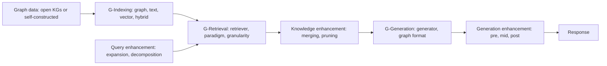

# Graph Retrieval-Augmented Generation: A Survey

> [!summary] One-sentence positioning
> The first broad survey of GraphRAG. It formalises a three-stage workflow (G-Indexing, G-Retrieval, G-Generation), catalogues techniques, training, tasks, benchmarks and industry systems, and lists open challenges. It is a taxonomy, not an empirical comparison. (PDF pp. 1, 3, 7–8, 29–30)

*Legend: **[Analytical inference]** (分析性归纳) marks my own judgement, not an author claim. Page numbers are PDF page numbers (the PDF is 41 pages; the PDF page number equals the printed page 111:N minus 110). Items I could not confirm are written as "not stated" or null.*

---

## 1. Basic information

| Field | Content |
|---|---|
| Authors | Boci Peng*, Yun Zhu* (equal contribution), Yongchao Liu, Xiaohe Bo, Haizhou Shi, Chuntao Hong, Yan Zhang† (corresponding), Siliang Tang. Affiliations: Peking University, Zhejiang University, Ant Group, Renmin University of China, Rutgers University (PDF p. 1) |
| Year | 2024 (arXiv v2, 10 Sep 2024) (PDF p. 1) |
| Source | arXiv:2408.08921v2 [cs.AI]; typeset as J. ACM 37(4), Article 111, Sep 2024. Companion repository: https://github.com/pengboci/GraphRAG-Survey (PDF pp. 1–2) |
| DOI | Not stated; the paper shows only a placeholder ("XXXXXXX.XXXXXXX"), so null (PDF pp. 1–2) |
| Research domains | Retrieval-augmented generation; knowledge graphs; graph neural networks; LLMs |
| Research type | Survey / literature review |
| Research object | Methods that retrieve graph elements (nodes, triplets, paths, subgraphs) to augment LLM generation |
| Study area | No geographic area |
| Spatial scale | Not applicable |
| Time range | Literature up to about mid-2024 (references include 2024 arXiv papers, e.g., Aug 2024); the review window is not stated (PDF pp. 31–41) |

---

## 2. Background and research problem

### 2.1 Research background
- LLMs lack domain-specific knowledge, real-time information and proprietary knowledge, which can cause "hallucination"; RAG supplements them with retrieved external text (PDF p. 2).
- GraphRAG retrieves graph elements "containing relational knowledge" from a pre-constructed graph database instead of text snippets (PDF pp. 2–3, Fig. 1).

### 2.2 Literature gap (as stated by the authors)
1. **Limits of traditional RAG** that motivate GraphRAG (PDF p. 2):
   - *Neglecting relationships:* text is interconnected, and RAG misses relational knowledge not captured by semantic similarity (example: citation links between papers).
   - *Redundant information:* concatenated snippets make long contexts and the "lost in the middle" problem.
   - *Lacking global information:* RAG retrieves only a subset of documents, so it struggles with Query-Focused Summarization (QFS).
2. **Gap in prior surveys:** earlier RAG surveys touch on GraphRAG but concentrate on textual data; this survey emphasises indexing, retrieval and use of structured graph data (PDF p. 5).
3. **Gap relative to LLMs-on-graphs and KBQA surveys:** GraphRAG retrieves graph elements from an external graph database using queries, which previous surveys on LLMs on graphs do not cover; KBQA is a subset (IR-based) of GraphRAG applications (PDF p. 5).

### 2.3 Research objectives and questions
- **Objective:** to give a systematic review of GraphRAG, with a formal definition and a universal workflow, plus techniques, training methods, tasks, benchmarks, application domains, metrics, industry systems, challenges and future directions (PDF pp. 3–4).
- **Contributions (stated, PDF p. 3):** (1) a comprehensive review with a formal definition and the G-Indexing / G-Retrieval / G-Generation workflow; (2) analysis of core technologies and training methods per stage; (3) tasks, benchmarks, domains, metrics, challenges, future directions and an inventory of industry systems.
- **Hypotheses:** none ("原文未提出明确假设"); it is a survey.

---

## 3. Theory and conceptual framework

### 3.1 Core concepts

| Concept | Definition or use in the paper | Operationalisation | Obsidian link |
|---|---|---|---|
| GraphRAG | "Framework that leverages external structured knowledge graphs to improve contextual understanding of LMs" (paraphrased from PDF p. 7); retrieves nodes, triples, paths or subgraphs | Three stages: G-Indexing, G-Retrieval, G-Generation (PDF pp. 7–8) | [[GraphRAG]] |
| Vector RAG / traditional RAG | RAG that retrieves text snippets, chiefly by semantic similarity; the survey treats it as the baseline that GraphRAG improves on (PDF p. 2) | Not defined as a separate formal object | [[Vector_RAG]] |
| Text-Attributed Graph (TAG) | Graph with textual attributes on nodes and edges; knowledge graphs are a typical case (PDF p. 6) | G = (V, E, A, {x_v}, {e_ij}) (PDF p. 6) | [[Text_Attributed_Graph]] |
| Graph-Based Indexing (G-Indexing) | Identify or construct a graph database and establish indices; determines retrieval granularity (PDF p. 7) | Graph, text, vector and hybrid indexing (PDF pp. 9–10) | [[Graph_Based_Indexing]] |
| Graph-Guided Retrieval (G-Retrieval) | Extract relevant elements (entities, triplets, paths, subgraphs) given a query (PDF p. 7) | Retriever type × paradigm × granularity × enhancement (PDF pp. 10–17) | [[Graph_Guided_Retrieval]] |
| Graph-Enhanced Generation (G-Generation) | Synthesise outputs from retrieved graph data and the query (PDF p. 8) | Generators, graph formats, generation enhancement (PDF pp. 17–22) | [[Graph_Enhanced_Generation]] |
| Retrieval granularity | Form of retrieved knowledge: nodes, triplets, paths, subgraphs, hybrid (PDF pp. 13–15) | Taxonomy in Section 6.3 | [[Retrieval_Granularity]] |
| Multi-hop reasoning | Used in the text only through "n-hop paths", "2-hop reasoning", "reasoning chains" (PDF pp. 9, 13–14); no separate definition | Indirect: path retrieval, iterative retrieval, query decomposition | [[Multi_Hop_Reasoning]] |

### 3.2 Theoretical foundations
- **Message-passing GNNs:** classical GNNs (GCN, GAT, GraphSAGE) are defined through a message / aggregate / update scheme (Eq. 1) and a readout (Eq. 2) used for retrieval and generation components (PDF p. 6) → [[Kipf_2017_Semi_Supervised_Graph_Convolutional_Networks]].
- **Probabilistic decomposition of GraphRAG:** the answer distribution p(a | q, 𝒢) is decomposed into a graph retriever p_θ and an answer generator p_φ (Eqs. 3–4) (PDF p. 7). No new theory is claimed.
- **Language models:** discriminative (BERT, RoBERTa, SentenceBERT) and generative (GPT, LLaMA) models as retrieval and generation components (PDF p. 6).

### 3.3 Concept relationships
The workflow has three stages with enhancement steps (PDF pp. 4, 7–8, Fig. 2):

---

## 4. Data and methods

### 4.1 Research design
Narrative, taxonomy-based literature review. The survey organises GraphRAG work by workflow stage (Sections 5–7), then training (Section 8), applications and evaluation (Section 9) and future directions (Section 10). **[Analytical inference]** The text I read does not describe a review protocol (databases searched, search strings, date window, inclusion or exclusion criteria, or the number of papers screened).

### 4.2 Data (literature and resources covered)

| Data or sample | Source | Quantity and time | Spatial granularity | Use | Limitation |
|---|---|---|---|---|---|
| Reviewed GraphRAG and related papers | Reference list (PDF pp. 31–41) | Number of reviewed works not stated; in-text citations reach [204] (PDF p. 5); includes papers up to 2024 | Not applicable | Taxonomy construction | Selection process not described |
| Open knowledge graphs | Wikidata, Freebase, DBpedia, YAGO, ConceptNet, ATOMIC; domain KGs CMeKG, CPubMed-KG, Wiki-Movies, GR-Bench, GraphQA (PDF pp. 8–9) | As listed | Not applicable | Examples of graph data sources | Counts and sizes not given |
| Self-constructed graph data | Document graphs, entity-relation KGs from text, patent-phrase graph, customer-service issue graphs (PDF p. 9) | Examples only | Not applicable | Examples of graph construction | Method-specific |
| Benchmarks and tasks | Table 1: KBQA (WebQSP, WebQ, CWQ, GrailQA, QALD10-en, SimpleQuestions, MetaQA, Natural Question, TriviaQA, HotpotQA, Mintaka, FreebaseQA), CSQA, EL, RE, fact verification, link prediction, dialogue, recommendation (PDF p. 25) | As listed | Not applicable | Overview of evaluation practice | Table only maps methods to benchmarks; it reports no scores |
| GraphRAG-specific benchmarks | STARK, GraphQA, GRBench (1,740 questions, 10 domain graphs per PDF p. 28), CRAG (PDF pp. 27–28) | As listed | Not applicable | Evaluation of GraphRAG systems | The text gives "five domain knowledge graphs" for GR-Bench on p. 9 vs "10 domain graphs" on p. 28 (see 5.2) |
| Industrial systems | Microsoft GraphRAG, NebulaGraph GraphRAG, Ant Group GraphRAG (DB-GPT, OpenSPG, TuGraph), NaLLM and LLM Graph Builder (Neo4j) (PDF pp. 28–29) | Five systems | Not applicable | Industry inventory | Descriptions are brief |

### 4.3 Method flow (organisation of the survey)
1. **Context and positioning:** motivation (Section 1), comparison with RAG, LLMs on graphs and KBQA (Section 2) (PDF pp. 2–5).
2. **Preliminaries:** TAGs, GNNs, language models (Section 3) (PDF pp. 5–6).
3. **Formal overview:** Equations 3–6 and the three-stage workflow (Section 4) (PDF pp. 7–8).
4. **Stage-by-stage taxonomy:** G-Indexing (Section 5), G-Retrieval (Section 6), G-Generation (Section 7) (PDF pp. 8–22).
5. **Training:** retriever, generator and joint training (Section 8) (PDF pp. 23–24).
6. **Applications and evaluation:** tasks, domains, benchmarks, metrics, industry (Section 9) (PDF pp. 24–29).
7. **Outlook and conclusion:** Sections 10–11 (PDF pp. 29–31).

### 4.4 Models, indicators and variables
This is a survey, so there is no own model. The paper gives formal definitions (numbering as in the paper).

Text-attributed graph (PDF p. 6):

$$\mathcal{G}=(\mathcal{V},\mathcal{E},A,\{x_v\}_{v\in\mathcal{V}},\{e_{i,j}\}_{i,j\in\mathcal{E}})$$

*V* nodes; *E ⊆ V × V* edges; *A ∈ {0,1}^{|V|×|V|}* adjacency matrix; *x_v* and *e_ij* textual attributes of nodes and edges.

GNN message passing and readout (PDF p. 6):

$$h_i^{(l)}=\mathrm{UPD}\Big(h_i^{(l-1)},\ \mathrm{AGG}_{j\in\mathcal N(i)}\,\mathrm{MSG}\big(h_i^{(l-1)},h_j^{(l-1)},e_{i,j}\big)\Big)\tag{1}$$
$$h_G=\mathrm{READOUT}_{i\in\mathcal V_G}\big(h_i^{(L)}\big)\tag{2}$$

*N(i)* neighbours of node *i*; *MSG* message function; *AGG* permutation-invariant aggregation (mean, sum, max); *UPD* update function; *READOUT* pooling. The layer superscript on *e_ij* in Eq. 1 was not reliably extracted from the PDF, so check the original.

GraphRAG objective and decomposition (PDF p. 7):

$$a^*=\arg\max_{a\in A}\,p(a\mid q,\mathcal G)\tag{3}$$
$$p(a\mid q,\mathcal G)=\sum_{G\subseteq\mathcal G}p_\phi(a\mid q,G)\,p_\theta(G\mid q,\mathcal G)\approx p_\phi(a\mid q,G^*)\,p_\theta(G^*\mid q,\mathcal G)\tag{4}$$

*q* query; *A* set of possible responses; *p_θ* graph retriever; *p_φ* answer generator; *θ, φ* learnable parameters; *G\** optimal subgraph. The approximation is needed because the number of candidate subgraphs grows exponentially with graph size.

Retrieval and generation stages (PDF pp. 7–8):

$$G^*=\text{G-Retriever}(q,\mathcal G)=\arg\max_{G\subseteq R(\mathcal G)}p_\theta(G\mid q,\mathcal G)=\arg\max_{G\subseteq R(\mathcal G)}\mathrm{Sim}(q,G)\tag{5}$$
$$a^*=\text{G-Generator}(q,G^*)=\arg\max_{a\in A}p_\phi(a\mid q,G^*)=\arg\max_{a\in A}p_\phi\big(a\mid\mathcal F(q,G^*)\big)\tag{6}$$

*Sim(·,·)* similarity between the query and graph data; *R(·)* narrows the search range of subgraphs for efficiency; *F(·,·)* converts graph data into a form the generator can process.

**Evaluation indicators discussed (not computed by the survey)** (PDF p. 28): Exact Match (EM), F1, Accuracy, BLEU, ROUGE-L, METEOR for generation; ratio of answer coverage to retrieved-subgraph size, query relevance, diversity and faithfulness for retrieval quality.

### 4.5 Method evaluation
- **Soundness:** The workflow decomposition (index, retrieve, generate) with explicit formal definitions gives a usable common vocabulary, and the stage-by-stage taxonomy is easy to map onto individual systems (PDF pp. 7–8).
- **Improvement over prior surveys (as claimed):** First comprehensive overview of GraphRAG and greater emphasis on graph data indexing and retrieval than earlier RAG surveys (PDF pp. 1, 3, 5).
- **Bias and validity risks [Analytical inference]:**
  - No stated search or inclusion protocol, so coverage and selection bias cannot be assessed.
  - Mostly descriptive: apart from one illustrative example (Fig. 1), the text gives no quantitative synthesis or head-to-head comparison of GraphRAG vs vector RAG.
  - The benefit statements ("more precise and comprehensive", "significantly enhances relevance, accuracy, and comprehensiveness", PDF pp. 1, 31) are supported by citations to individual papers, not by evidence collected in this survey.
  - The survey is heavily weighted to knowledge-graph QA (Table 1), so findings may not transfer to corpus-derived graphs or other tasks.
  - Most cited work is arXiv preprints from 2023–2024; peer-review status of many items is not indicated.
- **Missing for reproducibility [Analytical inference]:** list of papers screened, search dates, classification rules for ambiguous methods (the authors admit boundaries between granularities and between pre-generation enhancement and retrieval are blurry, PDF pp. 15, 21), and any coding scheme.

---

## 5. Main results

### 5.1 Core findings (main syntheses of the review)

1. **GraphRAG is positioned as a response to three RAG limitations, and a three-stage workflow is proposed.**
   - *Content:* Neglected relationships, redundant context ("lost in the middle") and missing global information are addressed by retrieving graph elements; the workflow is G-Indexing → G-Retrieval → G-Generation.
   - *Evidence:* Introduction, Fig. 1 (illustrative example), Fig. 2, Eqs. 3–6 (PDF pp. 2–4, 7–8).
   - *Authors' interpretation:* Graph data offers abstraction and summarisation that shorten the input, and subgraphs or communities help QFS (PDF p. 2).
2. **Graph retrieval design involves explicit trade-offs among retriever type, paradigm and granularity.**
   - *Content:* Non-parametric retrievers are efficient but may be inaccurate; LM- and GNN-based retrievers are more accurate but cost more computation, so hybrid and multi-stage designs are common. Once retrieval suits real-time use; iterative retrieval costs more time but can be more accurate. Finer granularities (nodes, triplets) favour speed and simple queries; complex scenarios often benefit from hybrid granularity.
   - *Evidence:* Sections 6.1.4, 6.2.4, 6.3.6 (PDF pp. 12–13, 15).
   - *Authors' interpretation:* choose by balancing accuracy and time complexity for the use case (PDF p. 13).
3. **Multi-step reasoning on graphs is handled mainly through path retrieval, iterative or adaptive retrieval, query decomposition and LLM agents.**
   - *Content:* Triplet retrieval alone may "lack contextual breadth and depth" for indirect relationships; path methods (rule-based n-hop paths, ToG beam search, plan-then-retrieve methods such as RoG) capture reasoning chains but face exponential path growth; adaptive retrieval lets the model decide when to stop (hop prediction, special tokens, LLM agents).
   - *Evidence:* Sections 6.2.2, 6.3.2–6.3.3, 6.4.1 (PDF pp. 12–16).
   - *Authors' interpretation:* path and subgraph granularity offer richer relational context (PDF p. 14).
4. **Generation needs a graph-to-model interface, and each interface has costs.**
   - *Content:* Graph languages (edge tables, natural language, code-like forms, syntax trees, node sequences) should be complete, concise and comprehensible; choice affects downstream performance. Graph embeddings avoid long contexts but struggle to preserve precise entity names and generalise poorly, and need open-source LMs.
   - *Evidence:* Sections 7.2.1–7.2.2 (PDF pp. 19–21).
   - *Authors' interpretation:* hybrid GNN+LM generators are promising but integrating the two modalities remains a challenge (PDF p. 19).
5. **The evaluation landscape is fragmented.**
   - *Content:* Table 1 maps methods to QA, IE and other tasks and benchmarks; metrics split into downstream task quality and retrieval quality; GraphRAG-specific benchmarks (STARK, GraphQA, GRBench, CRAG) exist, but "unified and standard benchmarks" are lacking.
   - *Evidence:* Section 9, Table 1, Section 10.6 (PDF pp. 25–28, 30).
6. **Open challenges listed.**
   - *Content:* Dynamic and adaptive graphs; multimodal integration; scalable retrieval (most methods are built for small KGs, thousands of entities per PDF p. 29); graph foundation models; lossless context compression; standard benchmarks; broader applications (healthcare, finance, legal, smart cities and IoT).
   - *Evidence:* Section 10 (PDF pp. 29–30).

### 5.2 Secondary findings and anomalies
- **Industrial systems:** Microsoft GraphRAG is described as building entity-based KGs and pre-generating community summaries to capture local and global relationships for QFS; the Ant Group system retrieves via keyword-to-node lookup with BFS or DFS subgraph traversal (PDF pp. 28–29).
- **Hybrid indexing:** HybridRAG retrieves vector and graph data simultaneously; EWEK-QA uses both text and knowledge graphs (PDF p. 10). This is the survey's closest point of contact with direct vector-plus-graph combination.
- **Where Edge et al. appears:** document-derived KG construction (PDF p. 9), community-summary text indexing (PDF p. 10), report-like community summaries as the graph format (PDF p. 20), post-generation merging of community answers scored by an LLM (PDF p. 22), and as the example of small-scale KG methods (PDF p. 29).
- **Training:** training-free methods dominate when using closed-source LLMs; training-based retrievers use distant supervision (shortest paths between question and answer entities), reinforcement learning or self-supervised pre-training; joint training is also covered (PDF pp. 23–24).
- **Inconsistencies noted:**
  - GR-Bench is described as including five domain KGs (PDF p. 9) but GRBench as covering 10 domain graphs (PDF p. 28).
  - The organisation paragraph says Section 3 outlines the GraphRAG process, but Section 3 is Preliminaries and the overview is Section 4 (PDF p. 4).
  - One sentence in Section 6.4.2 is cut off ("Liu et al. [101] train a PLM to", PDF p. 16).
  - Some reference entries are duplicated (e.g., Freebase [10]/[11], Bordes et al. [12]/[13]) (PDF p. 31).
  - Metric names "BERT4Score" and "GPT4Score" appear to be typographical variants of BERTScore and GPT-4 scoring (PDF p. 28).

### 5.3 Mapping to the survey's stated aims

| Aim | Delivered content | Fully delivered? | Evidence |
|---|---|---|---|
| Formal definition and universal workflow | Eqs. 3–6; three stages | Yes | PDF pp. 7–8 |
| Core technologies per stage | Sections 5–7 taxonomy | Yes (descriptive) | PDF pp. 8–22 |
| Training methods | Section 8 | Yes | PDF pp. 23–24 |
| Tasks, benchmarks, domains, metrics, industry | Section 9, Table 1 | Yes, descriptive; no scores reported | PDF pp. 24–29 |
| Challenges and future directions | Section 10 | Yes | PDF pp. 29–30 |
| "Comprehensive" coverage claim | No review protocol stated | Cannot be verified | PDF pp. 1, 3 |

---

## 6. Discussion and contributions

### 6.1 Theoretical contribution
- A formal, probabilistic framing of GraphRAG as retriever and generator over a text-attributed graph (Eqs. 3–6) (PDF pp. 6–8).
- A conceptual separation of GraphRAG from RAG, LLMs on graphs and KBQA (PDF pp. 4–5).

### 6.2 Methodological contribution
- A taxonomy of GraphRAG components: indexing types, retriever types, retrieval paradigms, granularities, enhancement strategies, generator and graph-format choices, and training regimes (PDF pp. 8–24).

### 6.3 Empirical contribution
- No new experiments. It consolidates benchmark and metric usage (Table 1) and an inventory of industrial systems (PDF pp. 25–29).

### 6.4 Practical or policy implications
- The authors state that GraphRAG can serve e-commerce, biomedical, academic, literature, legal and other scenarios, and suggest broader applications such as smart cities and IoT (PDF pp. 26–27, 30). **These are descriptions and prospects, not verified effects.**

---

## 7. Limitations and future research

### 7.1 Limitations explicitly acknowledged by the authors
- GraphRAG is "still in its early stages" (PDF p. 3), and there are no unified, standard benchmarks (PDF p. 30).
- Most methods rely on static databases (PDF p. 29) and are tailored for small-scale KGs (PDF p. 29).
- Graph languages can yield overlong contexts; embeddings struggle to preserve precise information and generalise poorly (PDF p. 21).
- Boundaries between retrieval granularities, and between retrieval and pre-generation enhancement, are not clear-cut (PDF pp. 15, 21).
- Query rewriting, common in RAG, is not covered in GraphRAG discussion (PDF p. 15).

### 7.2 Further limitations identified **[Analytical inference]**
1. **No review protocol and no quantitative synthesis** (basis: Sections 1–4 describe none).
2. **Comparative claims rest on citation, not evidence collected here.** For example, the claim that GraphRAG improves accuracy and comprehensiveness over RAG is stated in the abstract and conclusion (PDF pp. 1, 31); no comparison tables of GraphRAG vs vector RAG scores are provided (basis: Table 1 lists benchmarks and methods only).
3. **QA-centric evidence base.** The benchmarks and tasks emphasise KBQA over fixed KGs (PDF p. 25), which differs from corpus-derived graphs built by LLM extraction.
4. **Multi-agent aspects are thin.** LLM agents appear as retrievers or reasoners over graphs (PDF pp. 13, 15), and the text I read does not discuss multi-agent coordination or shared graph memory.
5. **Cost and efficiency are discussed qualitatively** (PDF pp. 12–13), without a systematic comparison of indexing or latency costs against vector RAG.
6. **Quality of graph construction** (entity extraction errors, hallucinated relations) receives little critical treatment in the sections I read.

### 7.3 Future research directions
- **Authors' suggestions:** dynamic and adaptive graphs; multimodal integration; scalable retrieval for million- to billion-entity KGs; combining with graph foundation models; lossless compression of retrieved context; standard benchmarks; broader applications (healthcare, finance, legal and compliance, smart cities and IoT) (PDF pp. 29–30).
- **Analytical suggestions [Analytical inference]:** controlled comparisons of vector RAG, GraphRAG and hybrid retrieval on the same corpus; benchmarks that separate multi-hop from global-sensemaking questions; evaluation of graph-construction quality; study of graph memory shared across LLM agents.

---

## 8. Key evidence and quotable content

| Use | Original short quote or accurate paraphrase | Page | Reminder |
|---|---|---|---|
| Positioning | "GraphRAG leverages structural information across entities to enable more precise and comprehensive retrieval, capturing relational knowledge and facilitating more accurate, context-aware responses." | PDF p. 1 | Verbatim; an author claim, not a measured result |
| Problem with RAG | "Traditional RAG fails to capture significant structured relational knowledge that cannot be represented through semantic similarity alone." | PDF p. 2 | Verbatim; context is the citation-network example |
| Relation to RAG | "GraphRAG can be seen as a branch of RAG, which retrieves relevant relational knowledge from graph databases instead of text corpus." | PDF p. 5 | Verbatim fragment |
| Multi-hop-relevant limitation | "directly retrieving triplets from graph data may still lack contextual breadth and depth, thus being unable to capture indirect relationships or reasoning chains." | PDF p. 14 | Verbatim fragment; motivates path and subgraph retrieval |
| Formalisation | Paraphrase: GraphRAG is modelled as a graph retriever p_θ(G \| q, 𝒢) and an answer generator p_φ(a \| q, G), approximated using one optimal subgraph G\*. | PDF p. 7 | Paraphrase of Eqs. 3–4 |
| Trade-off | Paraphrase: iterative retrieval can improve accuracy but costs more time, especially when LLMs act as retrievers; once retrieval suits real-time use. | PDF p. 13 | Paraphrase |
| Scale limitation | "most contemporary methods are tailored for small-scale knowledge graphs" | PDF p. 29 | Verbatim fragment; the sentence cites Edge et al. as the example |
| Benchmarks | "GraphRAG is a relatively new field that lacks unified and standard benchmarks for evaluating different methods." | PDF p. 30 | Verbatim |

---

## 9. Relation to my research

**Research context (user-supplied).** Overall: How can Graph AI tools (especially GraphRAG) be used to define research gaps and solution space to support the integration of TOD and NbS design for reducing hydrological and ecological impacts near San Tin Technopole? Focus: How does GraphRAG improve multi-hop reasoning, context retrieval, and decision-making in multi-agent LLM systems compared to standard vector-based RAG?

**Overall relevance [Analytical inference]:** High for the GraphRAG-vs-vector-RAG part of the focus question as a map of the design space and a source of leads; partial as evidence, because the survey reports no head-to-head empirical comparison, treats multi-agent aspects only lightly, and has no hydrology, ecology or planning content.

**How the survey's taxonomy maps onto the focus question [Analytical inference, using the survey's content]:**

| Focus element | Relevant survey content | What is missing |
|---|---|---|
| Multi-hop reasoning | Path and subgraph retrieval (PDF pp. 14–15); iterative and adaptive retrieval incl. ToG-style LLM agents (PDF p. 13); query decomposition (PDF p. 16); plan-then-retrieve (RoG) (PDF p. 12) | No consolidated evidence that GraphRAG beats vector RAG on multi-hop tasks; the word "multi-hop" appears mainly in reference titles |
| Context retrieval | Graph, text, vector and hybrid indexing (PDF pp. 9–10); retriever types (PDF pp. 11–12); knowledge merging and pruning (PDF pp. 16–17); graph languages and "lost in the middle" (PDF pp. 2, 21) | No quantitative retrieval-quality comparison against vector RAG |
| Decision-making | Post-generation enhancement and verification (KALMV verifier), answer merging (PDF p. 22); application domains including biomedical decision-making (PDF pp. 26–27) | Decision quality is not a studied outcome |
| Multi-agent LLM systems | LLM-based agents choosing retrieval tools or granularities (PDF pp. 13, 15) | No multi-agent coordination, shared graph memory or role-specialised retrieval |
| Versus standard vector RAG | The three RAG limitations (PDF p. 2); HybridRAG's combined vector and graph retrieval (PDF p. 10) | No controlled comparison |

- **Theory worth borrowing:**
  - The retriever–generator decomposition (Eqs. 3–6) for stating precisely what changes between vector RAG (retrieve text) and GraphRAG (retrieve a subgraph).
  - Text-attributed graph as a unifying data model.
  - The three RAG limitations as hypotheses to test: neglected relationships, redundant context, missing global information (PDF p. 2).
- **Reusable methods or indicators:**
  - The taxonomy dimensions as a design checklist for your own pipeline: indexing type, retriever, paradigm, granularity, enhancement, graph format.
  - Retrieval-quality metrics: answer coverage versus retrieved-subgraph size, query relevance, diversity, faithfulness (PDF p. 28).
  - Hybrid indexing (graph plus vector) as a fair baseline construction (PDF p. 10).
- **Comparable data or cases:** Domain KGs are mostly biomedical, e-commerce, academic and legal (PDF pp. 9, 26–27). None in hydrology, ecology, urban planning or transport. "Smart cities and IoT" appears only as a future application (PDF p. 30).
- **Arguments it can support:**
  - GraphRAG is a distinct family from text RAG, motivated by relational knowledge, redundancy and global-information limits (PDF pp. 2, 5).
  - Retrieval granularity (triplets vs paths vs subgraphs) matters for indirect relationships and reasoning chains (PDF p. 14).
  - Standard benchmarks are lacking and most methods are tested on small KGs, which supports a case for a domain-specific, application-driven evaluation (PDF pp. 29–30).
- **Possible conflicts or cautions:**
  - The survey's performance statements are not backed by synthesised evidence; do not cite it as proof that GraphRAG outperforms vector RAG. For empirical evidence use primary papers such as Edge et al., which reports gains for global sensemaking questions only.
  - Its benchmark base is QA over fixed knowledge graphs, whereas your use case would build a graph from heterogeneous literature and spatial data.
- **Research gaps this suggests:**
  - Controlled GraphRAG vs vector RAG vs hybrid comparisons, including multi-hop and global questions on the same corpus.
  - Graph-structured shared memory for multi-agent LLM systems, with role-specific retrieval.
  - Domain-specific graph construction and evaluation for environmental planning (TOD, NbS, hydrology, ecology), including how to bring non-textual spatial data into a text-attributed graph (the survey flags multimodality as an open challenge, PDF p. 29).

---

## 10. Literature relationship network

*No existing Obsidian notes were provided ("無"). Two target notes below were produced earlier in this conversation, so they are linked by their real file names and marked "Existing (made earlier)". The other links are unresolved links built from this paper's text and reference list, marked "To create". Re-validate once more notes are added.*

### 10.1 Strong relationships

| Linked paper | Relation type | Explanation | Basis | Confidence | Note status |
|---|---|---|---|---|---|
| [[Edge_2025_GraphRAG_Query_Focused_Summarization]] | Method similar | Reviewed as a representative GraphRAG method: LLM-built entity KG, community summaries as text index and graph format, scored community answers merged post-generation; also cited as the small-scale-KG example. The survey cites the 2024 arXiv version [32] | PDF pp. 9, 10, 20, 22, 28, 29 | High | Existing (made earlier) |
| [[Kipf_2017_Semi_Supervised_Graph_Convolutional_Networks]] | Theoretical foundation | GCN is named as a classical GNN; the survey's message-passing definition (Eq. 1) and GNN generators and retrievers build on this family | PDF pp. 6, 18 | High | Existing (made earlier) |
| [[Gao_2023_RAG_Survey]] | Extension | Earlier RAG survey (arXiv Dec 2023; listed as 2024 in the reference list) that this survey says it differs from by focusing on structured graph data | PDF pp. 4–5 | High | To create |
| [[He_2024_G_Retriever]] | Method similar | PCST-based subgraph retrieval; vector indexing of node and edge text; GraphQA benchmark | PDF pp. 9, 10, 11, 12 | High | To create |
| [[Luo_2024_Reasoning_on_Graphs]] | Method similar | RoG: LLM generates relation-path plans, then paths are retrieved; example of query expansion, plan-based multi-stage retrieval and path granularity | PDF pp. 12, 14, 15 | High | To create |
| [[Sun_2024_Think_on_Graph]] | Method similar | ToG: LLM agent performs beam search on KGs; example of adaptive iterative retrieval and path retrieval | PDF pp. 13, 14 | High | To create |
| [[Mavromatis_2024_GNN_RAG]] | Method similar | GNN-based retriever scoring entities, then retrieving shortest paths | PDF pp. 12, 13 | High | To create |
| [[Wang_2023_Knowledge_Graph_Prompting]] | Method similar | KGP: document graph with LLM-based iterative retrieval over neighbour context. The survey lists it as 2024 (AAAI 2024); the earlier Edge note cites it as 2023 | PDF pp. 9, 13 | Medium | To create |
| [[Gutierrez_2024_HippoRAG]] | Method similar | KG built from documents; Personalized PageRank used to rank retrieved candidates | PDF pp. 9, 16 | Medium | To create |
| [[Sarmah_2024_HybridRAG]] | Method similar | Retrieves vector and graph data simultaneously (hybrid indexing); the survey's explicit example of combining vector and graph retrieval | PDF p. 10 | High | To create |
| [[Jin_2024_Graph_Chain_of_Thought]] | Data similar | Source of GR-Bench / GRBench and an LLM-agent method that adaptively selects granularities | PDF pp. 9, 15, 27–28 | Medium | To create |

### 10.2 Concept, method and case nodes

| Node | Type | Role in this paper | Suggested connection direction |
|---|---|---|---|
| [[GraphRAG]] | Concept | Central subject | GraphRAG method and evaluation papers |
| [[Vector_RAG]] | Concept | Baseline family contrasted | RAG baselines and embedding-retrieval papers |
| [[Retrieval_Augmented_Generation]] | Domain | Parent field | RAG surveys and benchmarks |
| [[Knowledge_Graph_Construction_with_LLMs]] | Domain | Self-constructed graph data via LLM extraction | KG construction papers |
| [[Graph_Neural_Networks]] | Domain | GNN retrievers and generators | GNN papers |
| [[Text_Attributed_Graph]] | Concept | Unifying data model | Graph-text papers |
| [[Graph_Based_Indexing]] | Concept | Stage 1 of the workflow | Indexing and graph database papers |
| [[Graph_Guided_Retrieval]] | Concept | Stage 2 of the workflow | Retriever papers |
| [[Graph_Enhanced_Generation]] | Concept | Stage 3 of the workflow | Generator and prompting papers |
| [[Retrieval_Granularity]] | Concept | Nodes, triplets, paths, subgraphs | Multi-hop retrieval papers |
| [[Multi_Hop_Reasoning]] | Concept | Path, iterative and decomposition-based methods | Multi-hop QA papers |
| [[Iterative_Retrieval]] | Method | Adaptive and non-adaptive retrieval loops | Agent and reasoning-on-graph papers |
| [[Query_Decomposition]] | Method | Splitting queries into sub-queries | Multi-hop and agent papers |
| [[Graph_To_Text_Serialization]] | Method | Graph languages for LM input | Prompting and graph-encoding papers |
| [[Taxonomy_Based_Literature_Review]] | Method | The survey's own design | Other reviews of the field |

### 10.3 Relationship summary
Built from this paper's text and reference list only. The survey is a hub node for the GraphRAG branch of the literature network. It connects the RAG line (RAG surveys, vector retrieval, hybrid indexing), the KG-QA and reasoning-on-graphs line (RoG, ToG, GNN-RAG, G-Retriever, KGP) and the GNN line (GCN as the classic message-passing model). It treats Edge et al. as one representative method for corpus-level summarisation. It is a natural bridge between the Edge (GraphRAG) and Kipf (GCN) notes already in this conversation and the primary papers it cites. Re-validate after adding other notes.

---

## 11. Post-reading memo

> [!question] Questions worth pursuing
> 1. Which of the surveyed retrieval designs (path retrieval, iterative or adaptive retrieval, query decomposition) actually improve multi-hop answers over vector RAG on the same corpus, and by how much?
> 2. How would a shared graph store be organised for several role-specialised LLM agents (e.g., planner, hydrologist, ecologist), and what retrieval granularity should each agent use?
> 3. When does hybrid vector-plus-graph indexing (as in HybridRAG) beat either alone for literature-derived graphs?
> 4. How should graph-construction errors (missed or hallucinated relations) be measured and propagated into retrieval-quality evaluation?
> 5. How can non-textual spatial and hydrological data be represented in a text-attributed graph for retrieval?

> [!idea] Transferable methods or ideas
> - Use the stage-by-stage taxonomy as a design and reporting checklist for your own GraphRAG pipeline.
> - Use the retriever–generator decomposition (Eqs. 3–6) to state clearly what changes between a vector baseline and a graph variant.
> - Build baselines at several indexing levels (vector only, graph only, hybrid) and several granularities (triplets, paths, subgraphs).
> - Report retrieval-quality metrics (coverage versus retrieved-subgraph size, diversity, faithfulness) in addition to answer metrics.

> [!warning] Limits on use
> A survey with no stated review protocol, no quantitative synthesis and a QA-over-KG emphasis. Treat benefit statements as claims to verify in primary papers. It covers work up to about mid-2024, so later GraphRAG developments are not included. It has little on multi-agent LLM systems and nothing on planning, hydrology or ecology.

---

## 12. Reference leads

| Suggested note link | Reason | Relation to this paper | Priority |
|---|---|---|---|
| [[Sarmah_2024_HybridRAG]] | Combines vector and graph retrieval; the closest direct comparison point to your vector-vs-graph question | Key contrast | High |
| [[Sun_2024_Think_on_Graph]] | LLM agent explores multiple reasoning paths over a KG (adaptive iterative retrieval) | Method source | High |
| [[Luo_2024_Reasoning_on_Graphs]] | Plan-then-retrieve reasoning paths; multi-hop faithful reasoning | Method source | High |
| [[Mavromatis_2024_GNN_RAG]] | GNN retriever plus LLM reasoning; links GCN-style models to RAG | Method source | High |
| [[He_2024_G_Retriever]] | Subgraph retrieval with PCST and GraphQA benchmark | Method source / benchmark | High |
| [[Wang_2023_Knowledge_Graph_Prompting]] | Graph over documents with LLM traversal for multi-document QA | Key contrast | Medium |
| [[Gutierrez_2024_HippoRAG]] | KG from documents with Personalized PageRank retrieval | Method source | Medium |
| [[Jin_2024_Graph_Chain_of_Thought]] | GRBench benchmark and LLM-agent reasoning on graphs | Method source / benchmark | Medium |
| [[Fatemi_2023_Talk_Like_a_Graph]] | Effect of graph encoding choices on LLM performance | Method source | Medium |
| [[Gao_2023_RAG_Survey]] | General RAG survey to anchor the vector-RAG side | Survey entry | Medium |

---

## 13. Quick recap

- **One-sentence research question:** How can the fast-growing body of GraphRAG work be organised into a common workflow, taxonomy and set of open challenges?
- **One-sentence method:** A taxonomy-based narrative survey structured around G-Indexing, G-Retrieval and G-Generation, with training, tasks, benchmarks, metrics and industry systems, but no stated review protocol.
- **One-sentence conclusion:** GraphRAG is presented as a way to address RAG's relational, redundancy and global-information limits, with open problems in dynamic graphs, scale, multimodality, compression, benchmarks and applications.
- **One-sentence contribution:** A formal definition, a three-stage workflow and a comprehensive map of GraphRAG techniques and resources as of mid-2024.
- **One-sentence limitation:** Descriptive, with unverified comparative claims, a QA-over-KG evidence base and little on multi-agent systems or domain applications.
- **Worth close reading:** Yes, as the orientation map for your GraphRAG focus (Sections 4–7, 9.3, 10); use primary papers for evidence.
- **Recommended priority:** ★★★★★
