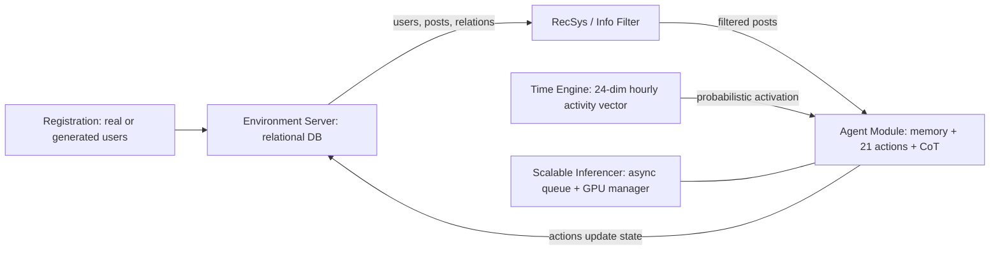

# OASIS: Open Agent Social Interaction Simulations with One Million Agents

> [!summary] One-sentence positioning
> OASIS is an open-source, modular LLM-agent simulator of X and Reddit (up to 1M agents). The authors replicate information spreading, group polarization and herd effects, and report scale-dependent changes, but validation against real data is partial. (PDF pp. 1, 7–11)

*Legend: statements marked **[Analytical inference]** (分析性归纳) are my own judgement, not claims by the authors. All page numbers are PDF page numbers; the PDF page number equals the printed page number. Where I could not read a value reliably, it is marked "to be checked".*

---

## 1. Basic information

| Field | Content |
|---|---|
| Authors | Ziyi Yang, Zaibin Zhang (equal first co-authors), Zirui Zheng et al.; 23 authors in total. Corresponding authors marked: Zhenfei Yin, Guohao Li, Jing Shao (PDF p. 1) |
| Year | 2025 (arXiv v5, 23 Mar 2025) (PDF p. 1) |
| Source | arXiv preprint, arXiv:2411.11581v5 [cs.CL]; project page https://github.com/camel-ai/oasis (PDF p. 1) |
| DOI | Not stated in the paper (null) |
| Research domains | Computational social science; LLM-based multi-agent simulation; social media modelling |
| Research type | Method/system paper with replication-style empirical experiments |
| Research object | LLM-driven simulated users on X (Twitter) and Reddit: information spreading, group polarization, herd effect, misinformation spreading |
| Study area | No geographic area; platform-based (X, Reddit) |
| Spatial scale | Not applicable (network/platform scale; 100 to 1,000,000 agents) |
| Time range | Reddit source comments from March 2023 (PDF p. 30). Collection dates of Twitter15/16 are not stated in this paper. Simulation horizons: 50 steps × 3 min = 150 min for propagation; 80 steps (polarization); 40 or 30 steps (Reddit); 60 steps (million-agent run) (PDF pp. 6–8, 10, 32, 34–35) |

---

## 2. Background and research problem

### 2.1 Research background
- Complex societal systems (social media, cities, ecosystems, financial markets) show emergent behaviour that cannot be predicted from individual actions alone; because real experiments are costly, scientists use mathematical models or agent-based models (ABMs) (PDF p. 2).
- Traditional ABM agents follow thresholds and miss context-dependent behaviour; LLMs can role-play and mimic human behaviour, which motivates LLM-based ABMs (PDF p. 2).
- X and Reddit differ in action space, recommendation algorithm (Info Filter) and network dynamics, so users behave differently across platforms (PDF p. 2).

### 2.2 Literature gap (as stated by the authors)
1. Existing LLM-based simulators are each built for one specific scenario, so pivoting to another phenomenon is time-consuming and resource-intensive (PDF pp. 1–2).
2. They simulate a limited number of agents, while real platforms have millions of users (PDF p. 1).
3. The importance of scale in LLM-based ABMs is "largely under-explored" (PDF p. 2).
4. Table 1 positions OASIS against Smallville, Sotopia, RecAgent, Agent4Rec, S3, HiSim, AgentTorch and AgentScope on agent count, environment, action space, RecSys, dynamic network and LLM type (PDF p. 3).

### 2.3 Research objectives and questions
- **Objective:** a generalizable and scalable social-media simulator built from modular components that can be switched between platforms (PDF pp. 1–3).
- **RQ1:** Can OASIS be adapted to various platforms and scenarios to replicate real-world phenomena? (PDF p. 6)
- **RQ2:** Does the agent population affect the accuracy of simulating group behaviour? (PDF p. 6)
- **Hypotheses:** The paper states no formal hypotheses ("原文未提出明确假设"). It presents "Findings" 1–5 plus a misinformation result.

---

## 3. Theory and conceptual framework

### 3.1 Core concepts

| Concept | Definition or use in the paper | Operationalisation | Obsidian link |
|---|---|---|---|
| LLM-based ABM | Agents driven by LLMs that role-play users and act in a simulated platform (PDF p. 2) | Llama-3-8B-Instruct as base LLM; agent module inherited from CAMEL; CoT reasoning with each action (PDF pp. 5, 7) | [[LLM_Based_Agent_Based_Model]] |
| Information propagation / spreading | Transmission of messages through a network, affected by structure, content and individual interactions (PDF p. 6) | Scale, depth, max breadth of the cascade; Normalized RMSE vs real cascades (PDF p. 7, 31) | [[Information_Propagation]] |
| Group polarization | Individuals with similar views adopt more extreme positions after exchanging opinions (PDF p. 8) | Pairwise judgement by GPT-4o-mini of whether later opinions are more conservative or extreme than round 0 (PDF pp. 8, 33) | [[Group_Polarization]] |
| Herd effect | Tendency to follow actions or opinions of a larger group (PDF p. 6) | Post/comment score = upvotes − downvotes after initial up-/down-treatment; disagree score (1–10) for counterfactual posts (PDF pp. 7, 34) | [[Herd_Effect]] |
| RecSys | Component that controls which posts agents see (PDF p. 4) | X: in-network ranked by likes + out-of-network by TwHIN-BERT similarity × recency × fan count; Reddit: hot score (PDF pp. 4–5, 26) | [[Recommender_System_RecSys]] |
| Scalable simulation | Simulating up to 10^6 agents via asynchronous inference and user generation (PDF p. 6) | Information channel with message queue and thread-safe dictionary; GPU manager (PDF p. 26) | [[Scalable_Agent_Simulation]] |
| Misinformation spreading | Spread of fabricated news vs official news among agents (PDF p. 10) | TF-IDF cosine similarity > 0.2 between simulated posts and 8 news items (PDF p. 11) | [[Misinformation_Spreading]] |

### 3.2 Theoretical foundations
- The paper does not build a new theory. It replicates phenomena from earlier studies: information spreading (Vosoughi et al., 2018), group polarization (Lindesmith et al., 1999) and herd/social-influence bias (Muchnik et al., 2013) (PDF p. 6) → [[Vosoughi_2018_Spread_of_True_and_False_News]], [[Lindesmith_1999_Social_Psychology]], [[Muchnik_2013_Social_Influence_Bias]].
- The ABM tradition is the general framework (Gilbert 2019; Ladyman et al. 2013 for emergent behaviour) → [[Agent_Based_Modeling]] (PDF p. 2).
- The scale argument borrows from scaling observations in vision and language modelling (Kaplan et al., 2020; Zhai et al., 2022) (PDF p. 2). **[Analytical inference]** This is an analogy, not a theory that is tested.

### 3.3 Concept relationships
The architecture has five or more interacting components, so the workflow is shown as a flowchart (PDF pp. 3–4, Fig. 2).

---

## 4. Data and methods

### 4.1 Research design
Simulation/modelling study with replication-style experiments. Quantitative comparison with real data is made only for information spreading (198 real cascades). Polarization and herd experiments are compared against LLM-judge outcomes or an existing human study, and the scale experiments are internal comparisons across agent counts (PDF pp. 6–10).

### 4.2 Data

| Data or sample | Source | Quantity and time | Spatial granularity | Use | Limitation |
|---|---|---|---|---|---|
| Real propagation cascades | Twitter15 (Liu et al., 2015) and Twitter16 (Ma et al., 2016) (PDF p. 7) | 198 instances, 100–700 users each, 9 categories; date of collection not stated here | User-level cascades | Initialise agents; compare simulated vs real scale/depth/max breadth | Previous posts only for selected windows (the hour before and two hours after the source post, each day over 3 days) because of collection cost; profiles enriched by GPT-3.5 Turbo (PDF p. 27) |
| Real X user profiles, follows, posts | X API (PDF p. 7) | Per cascade user; 3-day look-back (PDF p. 27) | User-level | Agent profiles, hourly activity vectors | Partial history; profiles abstracted from real people (PDF p. 36) |
| Core users for polarization | 196 real users from the spreading experiment (PDF p. 7) | 196 | User-level | Core agents in polarization and scale experiments | Selection criteria beyond "large following, different areas" not given |
| Synthetic users | LLM-generated from demographic distributions (age, gender, MBTI, profession, topics) (PDF pp. 27–28) | Up to 10^6; 3,600 and 10,000 for Reddit experiments (PDF p. 7) | Agent-level | Large-scale populations | Dimensions treated as independent and identically distributed (PDF p. 28); abstraction gap acknowledged (PDF p. 36) |
| Reddit comments and generated posts | Pushshift Reddit, March 2023 (PDF p. 30) | 116,932 comments, 7 topics; posts generated by an LLM from comments (PDF p. 30) | Comment-level | Herd-effect replication | Posts are LLM-generated, not original posts |
| Counterfactual statements | Dataset from Meng et al. (2022) (PDF p. 30) | 21,919 entries; subsets of 219 / 2,191 / 21,919 posts by scale (PDF p. 35) | Statement-level | Counterfactual herd experiment | Synthetic, fact-type statements |
| Official news and fabricated misinformation | Authors' own: 4 pairs (technology, education, entertainment, health) (PDF pp. 35–36) | 4 true + 4 fake; 733,824 simulated posts analysed (PDF p. 11) | Post-level | Million-agent misinformation run | Fakes were written to resemble the true items; no real-world baseline |
| Ablation topics | Random subset of the 198 cascades (PDF p. 20) | 28 topics | Cascade-level | RecSys, temporal feature, LLM backend ablations | Small subset |

### 4.3 Method flow
1. **Registration phase:** Input: name, self-description, historical posts. Process: each agent receives a character description and an action description. Output: users registered in the Environment Server (PDF p. 3).
2. **Environment state:** A relational database stores users, posts, comments, relations, traces and recommendations; it can be updated dynamically (PDF p. 4, App. D.2 pp. 24–25).
3. **Recommendation:** RecSys ranks posts and caches the top ones in a recommendation table. On refresh, a random subset is sampled for the agent (PDF pp. 4–5, 25).
4. **Activation:** The Time Engine activates agents probabilistically from a 24-dimension hourly activity vector; 1 time step = 3 minutes (PDF pp. 5–6).
5. **Agent decision:** The LLM agent reads posts, its memory and persona, then outputs a JSON with "reason" and "functions" (21 possible actions) (PDF pp. 5, 22–24).
6. **State update and iteration:** Actions update the database; new posts or follow edges become visible in later steps (PDF p. 4).
7. **Scalable inference:** Asynchronous requests via a message queue plus a thread-safe response dictionary keyed by UUID; a GPU manager balances requests (PDF p. 26).
8. **Experiments:** (a) cascade replication on X; (b) polarization on a "Halen/Helen" dilemma; (c) Reddit herd effect vs a human study; (d) scale comparisons; (e) million-agent misinformation run; (f) ablations (PDF pp. 6–12).

### 4.4 Models, indicators and variables

| Name | Type | Definition or calculation | Role in study |
|---|---|---|---|
| Scale | Indicator | Number of unique users in the propagation (PDF p. 31) | Fit to real cascades |
| Depth | Indicator | Largest number of edges from the source post to any node (PDF p. 31) | Fit to real cascades |
| Max breadth | Indicator | Largest number of nodes at any single depth (PDF p. 31) | Fit to real cascades |
| Normalized RMSE | Indicator | See Eq. 7 below (PDF p. 31) | Error between simulation and real curves; used in ablations |
| Post score / comment score | Dependent variable | S_i = U_i − D_i (PDF p. 34) | Herd effect vs human study |
| Disagree score | Dependent variable | GPT-4o rating 1–10 of how much a comment disagrees with a counterfactual post; 1 = fully believing, 10 = fully opposing (PDF p. 34) | Herd effect in counterfactual posts |
| Conservative/extreme judgement | Dependent variable | Pairwise GPT-4o-mini choice (Answer1 / Answer2 / neutral) vs round-0 opinion (PDF p. 33) | Group polarization |
| Helpfulness | Dependent variable | Pairwise LLM judgement using Safe-RLHF-style criteria (PDF pp. 33–34) | Scale effect on opinion quality |
| Treatment group | Independent variable | Up-treated (one initial like), down-treated (one initial dislike), control (PDF p. 7) | Herd effect |
| Agent scale | Independent variable | 196 / 10,196 / 100,196 (polarization); 100 / 1k / 10k (counterfactual herd) (PDF pp. 9–10, 35) | Scale effect |
| LLM type | Independent variable | Uncensored vs aligned Llama-3-8B (PDF p. 8); Qwen1.5-7B-Chat, InternLM2-chat-20B, Llama-3-8B-Instruct (PDF p. 22) | Polarization; backend ablation |

**Equation 1 — Reddit hot score (PDF p. 5):**

$$h = \log_{10}\left(\max\left(|u-d|,\,1\right)\right) + \operatorname{sign}(u-d)\cdot\frac{t-t_0}{45000}$$

*h* hot score; *u* upvotes; *d* downvotes; *t* submission time in seconds since the Unix epoch; *t*₀ = 1134028003.

**Equations 2–5 — X recommendation score (PDF p. 26):**

$$\text{Score}=R\times F\times S$$
$$R=\ln\!\left(\frac{271.8-(t_{\text{current}}-t_{\text{created}})}{100}\right)$$
$$F=\max\left(1,\log_{1000}(\text{fan count}+1)\right)$$
$$S=\operatorname{cosine\ similarity}(E_p,E_u)$$

*R* recency score; *F* fan-count score; *E_p* embedding of the post; *E_u* embedding of user profile and recent posts; *S* cosine similarity. The time unit in *R* is not stated in the paper (原文未说明).

**Equation 6 — hourly activity probability (PDF p. 27):**

$$P_{ij}=\frac{f_{ij}}{\max_k f_{kj}}$$

*P_ij* activity probability of user *i* in hour *j*; *f_ij* activity frequency of user *i* in hour *j*; the denominator is the maximum hour-*j* frequency across users in the group.

**Equation 7 — Normalized RMSE (PDF p. 31; the layout is garbled in the PDF text, so reading is to be checked against the original):**

$$\text{Normalized RMSE}=\frac{\sqrt{\frac{1}{n}\sum_{i=1}^{n}\left(y^{i}_{\text{simu}}-y^{i}_{\text{real}}\right)^{2}}}{y^{n}_{\text{real}}}$$

*n* is the maximum minute of the simulation; *y^i* is the metric value at minute *i*. The paper's text defines "y_simu, y_simu" (a typo: the second should presumably be y_real). Per-minute error is |y^i_simu − y^i_real| / y^n_real.

### 4.5 Method evaluation
- **Soundness:**
  - The modular design (environment, RecSys, agents, time engine, inferencer) and platform-inspired RecSys are reasonable for cross-platform reuse (PDF pp. 3–6).
  - Using real cascades with real follow lists and activity vectors for the spreading test is the most data-grounded part (PDF pp. 7, 27).
- **Improvement over prior methods (as claimed):** 21 actions, dynamic network, RecSys, open-source LLM and 1M agents together (Table 1, PDF p. 3). **[Analytical inference]** Table 1 is the authors' own comparison, and entries are not independently verified here.
- **Bias and validity risks [Analytical inference]:**
  - Only the spreading experiment is compared with real data, and the paper itself reports a depth mismatch and says averaging curves can offset errors (PDF p. 7).
  - Polarization uses one hypothetical dilemma, agents pre-assigned conservative views, an LLM judge, and no human comparison. "More conservative" is treated as "more extreme" (PDF p. 8).
  - The herd comparison against humans uses a differently designed human study and LLM-generated personas and posts (PDF pp. 7, 30, 34).
  - Scale experiments change several things at once: in the counterfactual experiment, cached posts per agent pool and posts created per step grow with agent count (PDF p. 35).
  - "Misinformation more influential" rests on TF-IDF similarity above 0.2, which measures lexical overlap, not belief or sharing (PDF p. 11).
- **Missing for reproducibility [Analytical inference]:**
  - Repeat-run variance is reported only for two topics (10 runs each, PDF p. 32).
  - Sampling temperature and other LLM decoding settings are not stated in the text I read.
  - The "uncensored" Llama variant is not identified.
  - Embedding model and settings for the Nomic Atlas visualisation are not given.
  - Human-study data used in Fig. 6 are not described in detail.
  - The number of judge calls and any position-bias control for pairwise LLM judging are not stated.

---

## 5. Main results

### 5.1 Core findings

1. **Spreading replication (Finding 1).**
   - *Content:* Simulated scale and max breadth track real cascades without evident offset; simulated depth is lower than real depth.
   - *Evidence:* Fig. 4 (198 instances, mean and 95% CI); Normalized RMSE around 30% (PDF pp. 7–8).
   - *Authors' interpretation:* validates OASIS; the depth gap "likely arises" from the complexity and precision of real RecSys and user profiles (PDF p. 7).
2. **Group polarization (Finding 2).**
   - *Content:* With conservative initial prompts, agents' advice about "Halen/Helen" becomes more conservative over 80 steps, more so with an uncensored model, which uses more extreme phrases such as "always better".
   - *Evidence:* Fig. 5 (bars per 10-step round, 196 core users) (PDF p. 8).
   - *Interpretation:* LLM agents tend toward extremism in social interaction (PDF p. 8).
3. **Herd effect vs humans (Finding 3).**
   - *Content:* Up-treated comments: agents and humans are close. Down-treated comments: human scores are significantly higher than agent scores.
   - *Evidence:* Fig. 6, seven topics, 95% CIs; red box on the Business panel (PDF p. 9).
   - *Interpretation:* agents follow others by disliking more; humans deliberate and are more likely to raise the like score (PDF p. 9).
4. **Scale and opinion diversity/helpfulness (Finding 4).**
   - *Content:* Going from 196 to 10,196 agents increases opinion diversity; the 10,196-agent set is judged more helpful than the 196-agent set, and 100,196 more helpful again.
   - *Evidence:* Fig. 7: 76.5% of opinions more helpful for 10k vs 196; 54.5% for 100k vs 10k; bar labels 43/3/150 and 85/4/107 (PDF pp. 9–10).
   - *Interpretation:* a larger user base exposes core users to more diverse and enriching responses (PDF p. 9).
5. **Counterfactual herd effect and scale (Finding 5).**
   - *Content:* At 100 agents the up-/down-treated/control groups do not differ; at 10,000 agents the down-treated group shows significantly higher disagree scores and scores rise over time.
   - *Evidence:* Fig. 8 (100 / 1,000 / 10,000 agents, 30 steps); Fig. 16 example of comments shifting toward rejecting the counterfactual statement (PDF pp. 10, 35).
   - *Interpretation:* large groups tend to guide agents toward "self-correction" (PDF p. 10).
6. **Million-agent misinformation run.**
   - *Content:* For each of four topics, posts similar to the fabricated news outnumber those similar to official news at nearly all steps; new follow edges show clustering.
   - *Evidence:* Fig. 9, Fig. 10; 733,824 posts; TF-IDF threshold 0.2; 24 A100 GPUs for about a week (PDF pp. 10–11).
   - *Interpretation:* misinformation has a more sustained influence (PDF p. 11).

### 5.2 Secondary findings and anomalies
- **RecSys ablation:** Without RecSys, spread usually ends early as a single-superuser broadcast, though some entertainment topics worked well because of dense fan networks (PDF p. 21). TwHIN-BERT and regular BERT clearly beat paraphrase-MiniLM-L6-v2 (Fig. 11a) (PDF p. 21).
- **Temporal-feature ablation:** Setting all hourly activity probabilities to 1.0 degrades fit, because all agents act too frequently (Fig. 12, PDF pp. 21–22). The two curves converge at later minutes in Fig. 12 **[Analytical inference, read from the figure]**.
- **LLM backend ablation:** Qwen1.5-7B-Chat, InternLM2-chat-20B and Llama-3-8B-Instruct yield different Normalized RMSE curves, especially for depth (Fig. 13, PDF p. 22). No explicit conclusion is drawn in the text.
- **Run-to-run stability:** The no-noise topic is stable across 10 runs; the topic with 33 additional posts diverges, with six of ten runs concentrated (PDF p. 32).
- **Efficiency:** 10k agents take 15 min per time step vs 0.83 min for 1k and 0.33 min for 100, all on 4 A100 GPUs (Table 2, PDF p. 20). 300 agents × 30 steps take 26 min on one A100 (PDF p. 32).
- **Finding 5 vs earlier herd result:** In the Reddit comment experiment (Finding 3) agents already show herd behaviour on down-treated items; in Finding 5 no herd effect appears at 100 agents. The paper does not reconcile the two settings beyond the difference in design.
- **Internal inconsistencies noted:** follow probability for core users is 0.2 in the main text (PDF p. 6) but 0.1 in the appendix (PDF p. 28); broken cross-reference "Section ??" (PDF p. 10); "Helen" and "Halen" are both used (PDF pp. 8, 33); Fig. 5 caption says red = more extreme while the legend says "More Conservative" (PDF p. 8); the propagation experiment is described as up to 50 steps (PDF p. 32) while the runtime example says 30 steps (PDF p. 32).

### 5.3 Mapping to research questions

| Question | Result | Supported? | Evidence |
|---|---|---|---|
| RQ1: replicate real-world phenomena across platforms | Scale/breadth match, depth too low; polarization and herd-like behaviour reproduced qualitatively; agents differ from humans on down-treated items | Partly | Figs. 4–6; PDF pp. 7–9 |
| RQ2: does agent population matter? | Diversity and LLM-judged helpfulness rise with scale; herd effect appears only at larger scale in the counterfactual setting | Partly (confounded by design changes) | Figs. 7–8; PDF pp. 9–10, 35 |
| Million-agent feasibility | A run with 196 core + 1M regular agents was executed | Yes (as feasibility) | PDF p. 10; Fig. 9–10 |
| "Misinformation is more influential" | Similar-post counts higher for misinformation | Weakly (proxy metric) | Fig. 9; PDF p. 11 |

---

## 6. Discussion and contributions

### 6.1 Theoretical contribution
The paper claims no new social theory. It offers a way to examine known phenomena (spreading, polarization, herding) in LLM-agent societies and observes that agents' behaviour differs from humans in the herd setting (PDF pp. 9, 12). **[Analytical inference]** The theoretical contribution is modest.

### 6.2 Methodological contribution
- Open-source, modular simulator with five components that can be adapted between X and Reddit (PDF pp. 2–6).
- Platform-style RecSys for X (interest + recency + follower count) and Reddit (hot score) (PDF pp. 4–5).
- Time Engine with real-data hourly activity vectors (PDF pp. 5, 27).
- Scalable asynchronous inference and a user-generation algorithm for up to 1M agents (PDF pp. 6, 26–28).

### 6.3 Empirical contribution
Quantified agreement with real cascades (Normalized RMSE around 30%, depth shortfall), ablations of RecSys/time engine/LLM, and scale-dependent observations on opinion diversity, helpfulness and herd effect (PDF pp. 7–12, 20–22).

### 6.4 Practical or policy implications
- The authors suggest OASIS can be a tool for studying complex systems, evaluating novel recommendation systems, or training LLMs with influence capabilities using agent feedback as reward (PDF pp. 1, 36). **These are proposals, not demonstrated effects.**
- The ethics section warns about fidelity, privacy and misuse for manipulating online discourse (PDF p. 37).

---

## 7. Limitations and future research

### 7.1 Limitations explicitly acknowledged by the authors
- RecSys is high-level; no collaborative filtering; misalignment with real propagation data (PDF p. 36).
- Real and generated user data abstract real individuals, leaving a gap to the real world (PDF p. 36).
- Missing platform features (bookmarking, tipping, purchasing, live streaming); text-only environment (PDF p. 36).
- Million-agent runs still need several days (PDF p. 36).
- RecSys struggles to model intermediary users because of data limitations (PDF p. 8).
- Averaging curves can cancel opposite errors across cascades (PDF p. 7).

### 7.2 Further limitations identified **[Analytical inference]**
1. **Partial validation.** Only one of the experiments uses real outcome data; basis: Sections 3.3–3.5 (PDF pp. 7–11).
2. **Validation scale mismatch.** Real-data alignment is tested with about 100–700 users per cascade and 300-agent runs (PDF pp. 7, 32), while the realism claim is made for 1M agents.
3. **LLM-judge dependence.** Polarization, helpfulness and disagree scores all rely on GPT-4o(-mini) judges with no human validation reported (PDF pp. 7–8, 34).
4. **Polarization design.** Pre-assigned conservative priors, a single scenario, and no control for sycophancy or mutual echoing (PDF p. 8).
5. **Scale confounds.** Feed size, posts per step and cache size change with agent count (PDF p. 35); diversity is judged visually from an embedding plot (PDF p. 9).
6. **Proxy for influence.** TF-IDF overlap with threshold 0.2 does not measure belief or sharing, and the four fakes were written to resemble the true items (PDF pp. 11, 35–36).
7. **Single small base model.** Most experiments use Llama-3-8B-Instruct (PDF p. 7); generalisation to other LLMs is only partly checked in the propagation ablation (PDF p. 22).
8. **Synthetic persona independence assumption.** Age, personality and profession are treated as i.i.d. variables (PDF p. 28), which can understate real correlations.
9. **Text inconsistencies** (see 5.2) reduce confidence in some reported settings.

### 7.3 Future research directions
- **Authors' suggestions:** more complex recommenders; multimodal content; extra platform actions; faster inference and databases; using OASIS to test new recommenders or train LLMs (PDF p. 36).
- **Analytical suggestions [Analytical inference]:** compare the vector-similarity RecSys against structure-aware retrieval; add human-validated judgement; run scale studies with fixed feed size; add repeated seeds and variance reporting; test other LLM families for the polarization and herd findings.

---

## 8. Key evidence and quotable content

| Use | Original short quote or accurate paraphrase | Page | Reminder |
|---|---|---|---|
| Definition | "The role of the RecSys is to control the information seen by agents, playing a crucial part in shaping the information flow." | PDF p. 4 | Verbatim; describes the authors' RecSys design, not a general claim |
| Method | Paraphrase: the Time Engine activates each agent probabilistically using a 24-dimensional vector of hourly activity probabilities, with one time step equal to 3 minutes. | PDF pp. 5–6 | Paraphrase |
| Result | "OASIS can replicate the information spreading process in the real world in terms of scale and maximum breadth without evident offset; however, the depth trend is smaller compared to real-world trends." | PDF p. 7 | Verbatim; the normalized RMSE of about 30% is averaged over curves |
| Result | "When faced with counterfactual posts, the agent exhibits herd effect only in response to dislikes, and this effect becomes more pronounced as the number of agents increases." | PDF p. 9 | Verbatim; scale is confounded with feed settings |
| Ablation | "removing the RecSys leads to the premature end of information spread, typically manifesting as broadcast behavior from a single superuser." | PDF p. 21 | Verbatim; for the 28-topic subset |
| Limitation | "More complex recommendation algorithms, such as collaborative filtering, have not been implemented in OASIS" | PDF p. 36 | Verbatim; the sentence continues in the original |
| Result (paraphrase) | The million-agent run found more posts similar to fabricated news than to official news at each topic, interpreted by the authors as greater influence of misinformation. | PDF p. 11 | Paraphrase; proxy metric (TF-IDF similarity) |

---

## 9. Relation to my research

**Research context (user-supplied).** Overall: How can Graph AI tools (especially GraphRAG) be used to define research gaps and solution space to support the integration of TOD and NbS design for reducing hydrological and ecological impacts near San Tin Technopole? Focus: How does GraphRAG improve multi-hop reasoning, context retrieval, and decision-making in multi-agent LLM systems compared to standard vector-based RAG?

**Overall relevance [Analytical inference]:** Weak and indirect (my earlier rating in this conversation: 2.5 / 10). The paper does not use GraphRAG, knowledge graphs, multi-hop reasoning evaluation, or any TOD/NbS/hydrology content.

- **Theory worth borrowing:**
  - A modular multi-agent architecture with a retrieval/filter layer between a shared state store and agents (Environment Server → RecSys → Agent Module) (PDF pp. 3–4). It can be an analogy for a multi-agent set-up where stakeholder agents (e.g., planner, hydrologist, ecologist) draw from a shared knowledge store.
  - The paper's claim that the information filter shapes information flow (PDF p. 4).
- **Reusable methods or indicators:**
  - The out-of-network RecSys is an embedding-similarity retrieval pipeline (TwHIN-BERT cosine similarity × recency × follower count) (PDF pp. 4–5, 26). It is structurally similar to vector-based retrieval and could serve as a description of a "vector baseline" **[Analytical inference]**.
  - Ablation design: remove the retrieval layer, swap embedding models, compare curves (PDF pp. 20–21).
  - Pairwise LLM-as-judge evaluation with explicit criteria (PDF pp. 33–34), usable with caution.
- **Comparable data or cases:** None for San Tin, TOD, NbS or hydrology. Not applicable.
- **Arguments it can support:**
  - Retrieval design matters in multi-agent LLM systems: without a recommender, spread stops early; a domain-adapted embedding model (TwHIN-BERT) beat a general model in their ablation (PDF pp. 12, 21). This supports a general point about retrieval quality, not specifically about GraphRAG.
- **Possible conflicts:**
  - The paper treats a similarity-based retriever as sufficient for its goal and notes lack of collaborative filtering as a limitation (PDF p. 36). It does not test any graph-structured retrieval, so it gives neither evidence for nor against GraphRAG.
  - Its claim that more agents give better opinions (PDF p. 9) is confounded by feed design and LLM-judge scoring, so it should not be used as evidence that scale improves decision quality **[Analytical inference]**.
- **Research gaps this suggests:**
  - No comparison of graph-based vs vector-based retrieval in an LLM multi-agent simulation.
  - No evaluation of multi-hop reasoning or decision quality in agents; OASIS agents act independently and are not cooperating on a task (PDF pp. 5, 20).
  - No domain-specific knowledge base in the simulated agents; their memory is a store of past posts, actions and reasons (PDF p. 5).

---

## 10. Literature relationship network

*No existing Obsidian notes were provided ("無"). All links below are unresolved links inferred from this paper's text and references; all are marked "to create". Re-check once other notes are added.*

### 10.1 Strong relationships

| Linked paper | Relation type | Explanation | Basis | Confidence | Note status |
|---|---|---|---|---|---|
| [[Vosoughi_2018_Spread_of_True_and_False_News]] | Theoretical foundation | OASIS replicates information spreading following this study and adopts its three metrics (scale, depth, max breadth) | PDF pp. 6–7 | High | To create |
| [[Muchnik_2013_Social_Influence_Bias]] | Theoretical foundation | The Reddit herd experiment follows its up-/down-treated/control design and category scheme | PDF pp. 6–7, 30 | High | To create |
| [[Muchnik_2013_Social_Influence_Bias]] | Contrast | Agents match humans on up-treated comments but differ on down-treated ones in the authors' comparison. Which human data underlie Fig. 6 is not fully specified | PDF p. 9, 34 | Medium | To create |
| [[Lindesmith_1999_Social_Psychology]] | Theoretical foundation | The dilemma scenario for group polarization is taken from this source | PDF pp. 6, 8 | Medium | To create |
| [[Li_2023_CAMEL]] | Method similar | Core features of the agent module are inherited from CAMEL | PDF p. 5 | High | To create |
| [[Zhang_2023_TwHIN_BERT]] | Method similar | TwHIN-BERT embeddings drive out-of-network recommendation; ablated against BERT and MiniLM | PDF pp. 4, 21 | High | To create |
| [[Dai_2023_Safe_RLHF]] | Method similar | Evaluation of helpfulness follows Safe-RLHF criteria with an LLM judge | PDF pp. 7, 9, 33 | Medium | To create |
| [[Park_2023_Generative_Agents]] | Extension | The time-step approach is described as similar to this work; OASIS extends to platform-specific environments and larger scale | PDF pp. 3, 6 (Table 1) | Medium | To create |
| [[Gao_2023_S3_Social_Network_Simulation]] | Extension | Table 1 lists S3 (X, 1,000 agents, 4 actions, no RecSys, no dynamic network) as a comparison; OASIS adds actions, RecSys, dynamic network, scale | PDF p. 3 | Medium | To create |
| [[Gao_2024_AgentScope]] | Method similar | Table 1 lists AgentScope as an open-source 1M-agent platform without a defined environment; the paper cites it with Chopra et al. as million-scale work | PDF pp. 2–3 | Medium | To create |
| [[Liu_2015_Real_Time_Rumor_Debunking]] | Data similar | Source of Twitter15 cascades | PDF p. 7 | High | To create |
| [[Ma_2016_Detecting_Rumors_RNN]] | Data similar | Source of Twitter16 cascades | PDF p. 7 | High | To create |
| [[Meng_2022_Locating_Editing_Factual_Associations]] | Data similar | Counterfactual statements used as post content | PDF p. 30 | High | To create |

### 10.2 Concept, method and case nodes

| Node | Type | Role in this paper | Suggested connection direction |
|---|---|---|---|
| [[LLM_Based_Agent_Based_Model]] | Concept | Central framing of the simulator | Other LLM social-simulation or multi-agent papers |
| [[Agent_Based_Modeling]] | Method | General modelling tradition | Classical ABM papers; LLM-ABM papers |
| [[Information_Propagation]] | Concept | Spreading cascades on X | Cascade modelling, rumor studies |
| [[Group_Polarization]] | Concept | Polarization experiment | Opinion-dynamics papers |
| [[Herd_Effect]] | Concept | Reddit herd experiments | Social-influence papers |
| [[Misinformation_Spreading]] | Concept | Million-agent run | Misinformation studies |
| [[Recommender_System_RecSys]] | Concept | Controls information flow | Retrieval/recommendation papers (including graph-based) |
| [[Embedding_Based_Post_Retrieval]] | Method | TwHIN-BERT similarity ranking | RAG and retrieval papers (vector-based baseline) |
| [[LLM_as_Judge_Evaluation]] | Method | Polarization, helpfulness, disagree scores | Evaluation-methodology papers |
| [[Normalized_RMSE]] | Method | Fit metric against real cascades | Simulation validation papers |
| [[Scalable_Agent_Simulation]] | Concept | Async inference, 1M agents | Large-scale agent platforms |
| [[Synthetic_LLM_Generated_User_Profiles]] | Data | Persona generation for large populations | Persona-generation and synthetic-population papers |
| [[Counterfactual_Herd_Experiment]] | Method | Counterfactual statements with up-/down-treatment | Misinformation and correction studies |
| [[LLM_Multi_Agent_Systems]] | Concept | Domain frame | Multi-agent LLM collaboration papers |

### 10.3 Relationship summary
Based on this paper's text and reference list only (no existing notes to cross-check). The paper sits in the LLM-based social-simulation branch, inheriting its agent module from CAMEL and its role-play framing from Generative Agents, while replicating three computational-social-science studies (Vosoughi, Muchnik, Lindesmith). It extends earlier X-simulators such as S3 in action space, RecSys and scale. It could bridge simulation papers and retrieval/recommendation papers through its embedding-similarity RecSys, but it has no link to graph-based retrieval or domain-knowledge agents. Relations should be re-validated once other notes are added.

---

## 11. Post-reading memo

> [!question] Questions worth pursuing
> 1. If the TwHIN-BERT similarity retriever were replaced by a graph-structured retriever over the follow/interaction network, would depth of simulated cascades (currently too low) move toward the real data?
> 2. How much of the "scale improves helpfulness/diversity" result survives when feed size and cache size are held fixed?
> 3. Do polarization results hold with a human-validated judge and a control for sycophancy or mutual echoing?
> 4. Which human dataset underlies the human curves in Fig. 6, and are the agent–human differences robust across LLMs?
> 5. What retrieval design would let stakeholder agents in a planning simulation reason over multi-hop relations rather than similarity alone?

> [!idea] Transferable methods or ideas
> - Retrieval-layer ablations (none, general embedding, domain embedding) with a per-time-step normalized error curve.
> - Time-engine style probabilistic activation to avoid synchronous agent behaviour.
> - Asynchronous request queue + UUID-keyed response dictionary + GPU manager for many concurrent LLM agents.
> - Pairwise LLM-judge evaluation with explicit criteria, to be paired with human validation.

> [!warning] Limits on use
> Findings apply to text-only X/Reddit-style simulations with mostly Llama-3-8B-Instruct agents, LLM-generated personas and posts, and LLM-based judges. Realism is validated only for cascade scale/breadth at about 100–700 users per cascade. No evidence is provided on GraphRAG, multi-hop reasoning, task-oriented multi-agent decision-making, or any spatial-planning or hydrological context.

---

## 12. Reference leads

| Suggested note link | Reason | Relation to this paper | Priority |
|---|---|---|---|
| [[Li_2023_CAMEL]] | Source framework for the agent module; useful for multi-agent design | Method source | High |
| [[Gao_2024_AgentScope]] | Multi-agent platform that the paper compares at 1M-agent scale | Key comparison | High |
| [[Park_2023_Generative_Agents]] | Foundational LLM-agent simulation with memory and time steps | Theoretical foundation / key comparison | High |
| [[Zhang_2023_TwHIN_BERT]] | Embedding model behind the vector-similarity RecSys | Method source | High |
| [[Gao_2023_S3_Social_Network_Simulation]] | Earlier X-style LLM simulator | Key comparison | Medium |
| [[Chopra_2024_Limits_of_Agency_in_ABMs]] | Cited as a million-scale ABM reference (PDF p. 2); bibliographic link to the AgentTorch entry in Table 1 not stated in the paper (information to be checked) | Key comparison | Medium |
| [[Vosoughi_2018_Spread_of_True_and_False_News]] | Defines the spreading metrics and the phenomenon replicated | Theoretical foundation | Medium |
| [[Muchnik_2013_Social_Influence_Bias]] | Human herd-effect study replicated | Key comparison | Medium |
| [[Dai_2023_Safe_RLHF]] | Source of helpfulness criteria used for the LLM judge | Method source | Medium |
| [[Ren_2024_Emergence_of_Social_Norms]] | Cited as LLM agent-society work on emergent norms (PDF p. 20) | Related multi-agent society study | Medium |

---

## 13. Quick recap

- **One-sentence research question:** Can a generalizable, scalable LLM-agent simulator of X and Reddit reproduce real social phenomena, and does agent population size change the results?
- **One-sentence method:** A five-component modular simulator (environment database, platform-style RecSys, LLM agents with memory and 21 actions, time engine, async inference) tested on cascade replication, polarization, herd effects, scale comparisons and a million-agent misinformation run.
- **One-sentence conclusion:** Scale and breadth of real cascades are matched at about 30% normalized RMSE with lower depth, and larger populations change diversity, helpfulness and herd behaviour in the authors' experiments.
- **One-sentence contribution:** An open-source, platform-adaptable LLM-agent simulator demonstrated up to one million agents.
- **One-sentence limitation:** Real-data validation is partial and several findings rely on LLM judges, proxy metrics and scale-confounded designs.
- **Worth close reading:** Depends on research topic (useful for architecture and RecSys ablation design; not for GraphRAG or TOD/NbS content).
- **Recommended priority:** ★★☆☆☆
