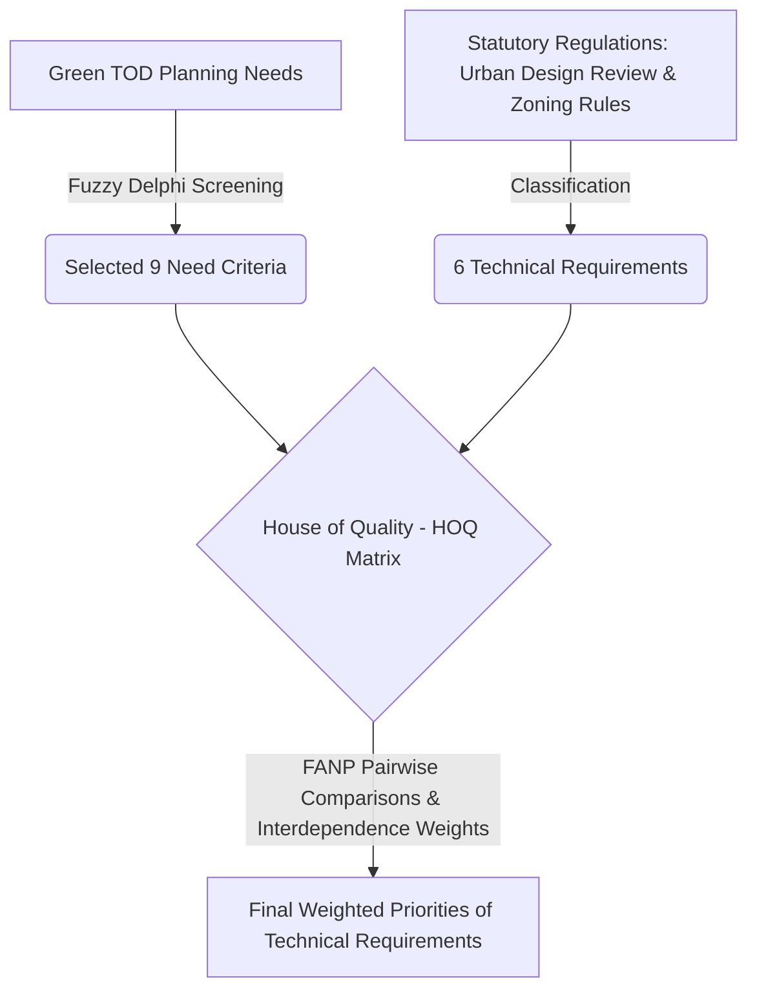

# Green Urbanism Embedded in TOD for Urban Built Environment Planning and Design

> [!summary] One-Sentence Summary
> This study integrates Fuzzy Delphi Technique (FDT), Quality Function Deployment (QFD), and Fuzzy Analytic Network Process (FANP) to develop a Multi-Criteria Decision-Making (MCDM) model for Green TOD, finding that conventional TOD dimension criteria outweigh ecological/green urbanism factors in empirical expert prioritization for station-area planning in New Taipei City (PDF pp. 1–12).

## 1. Basic Information

| Field | Content |
|---|---|
| Authors | Wei Huang, Wann-Ming Wey |
| Year | 2019 |
| Source | *Sustainability*, Vol. 11, No. 19, Article 5293 |
| DOI | 10.3390/su11195293 |
| Research Domain | [[Urban Planning]], [[Transit-Oriented Development]], [[Green Urbanism]] |
| Research Type | Methodological & Case Study (MCDM Modeling) |
| Research Object | Station-area built environment planning and design criteria under the Green TOD framework |
| Research Area | [[Xinzhuang District]], [[New Taipei City]], Taiwan |
| Spatial Scale | [[Station Area]] (500m walking radius around Taipei Rapid Transit Y18 Station) |
| Temporal Scope | 2019 (Data collection and expert evaluation timeframe) |

## 2. Research Background and Questions

### 2.1 Research Background
Conventional Transit-Oriented Development (TOD) focuses primarily on the sustainable transportation dimension (e.g., density, diversity, transit-supportive land uses, pedestrian-friendly design). However, it lacks adequate integration of ecological and environmental dimensions such as biodiversity, natural energy recycling, and microclimate regulation, which are critical for holistic urban sustainability (PDF pp. 1–2).

### 2.2 Literature Gap
Existing urban design and TOD planning frameworks treat transit accessibility and green urbanism in isolation. Previous literature and government planning practices have largely ignored how to systematically screen, operationalize, and weigh ecological criteria alongside traditional TOD criteria within local statutory land-use control and urban design regulations (PDF p. 2).

### 2.3 Research Objectives and Questions
- **Research Objectives:** To construct a hybrid decision-making model that screens Green TOD design criteria and ranks technical design requirements within current regulatory frameworks.
- **Research Questions:**
  1. What criteria constitute a comprehensive Green TOD framework across TOD and Green Urbanism dimensions?
  2. How can expert consensus filter out non-essential criteria for local built environment planning?
  3. What are the relative weights and priorities when Green TOD needs are mapped onto actual statutory urban design regulations?
- **Hypotheses / Propositions:** Original text does not state explicit formal hypotheses (Analytical Synthesis: operates as an exploratory decision-modeling framework).

## 3. Theoretical and Conceptual Framework

### 3.1 Core Concepts

| Concept | Definition / Usage in Paper | Operationalization | Obsidian Link |
|---|---|---|---|
| Green TOD (GTOD) | An advanced development mode combining conventional TOD and Green Urbanism to maximize resource efficiency, green building techniques, and ecological linkages in station peripheral areas (PDF p. 2). | Evaluated via 9 planning need criteria spanning land use, mobility, energy, and open space. | [[Green TOD]] |
| 6D Framework | An extension of Calthorpe's 3Ds (Density, Diversity, Design) and Cervero's 5Ds, adding "Distinction" to measure TOD built environments (PDF p. 4). | Represented by 6 key TOD-level criteria in the initial pool. | [[6D Framework]] |
| Green Urbanism | An urban design movement aiming to reduce urban ecological footprints and model urban metabolism on natural ecosystems via triple-zero goals (fossil fuel, waste, emissions) (PDF p. 4). | Operationalized through green building, renewable energy, waste, and water recycling criteria. | [[Green Urbanism]] |

### 3.2 Theoretical Foundations
1. **Green Urbanism Framework:** Draws on Beatley (2000) and Lehmann (2010) to incorporate ecological metabolism into urban built environments (PDF p. 4).
2. **TOD Built Environment Dimensions:** Grounded in Cervero & Kockelman (1997) 3Ds and subsequent 5D/6D extensions for travel demand and land-use integration (PDF p. 4).
3. **Multi-Criteria Decision Analysis (MCDA):** Uses Saaty's Analytic Network Process (ANP) extended with fuzzy logic to address complex interdependencies between user needs and technical specifications (PDF pp. 5–8).

### 3.3 Conceptual Relationships

## 4. Data and Methods

### 4.1 Research Design
A hybrid quantitative Multi-Criteria Decision-Making (MCDM) research design combining:
1. Fuzzy Delphi Technique (FDT) for criterion screening.
2. Quality Function Deployment (QFD) / House of Quality (HOQ) to map planning needs to technical specifications.
3. Fuzzy Analytic Network Process (FANP) to determine criteria weights under interdependency (PDF pp. 5–7).

### 4.2 Data

| Data / Sample | Source | Quantity & Time | Spatial Granularity | Purpose | Limitations |
|---|---|---|---|---|---|
| Expert Questionnaire Panel | Officials from New Taipei City, Consultants, Urban Planning Professors (PDF p. 8) | 10 experts surveyed (6 profiles detailed in Table 1; PDF p. 8); 2019 | City / Regional expert level | Rating FDT importance & FANP pairwise comparisons | Small sample size, reliance on expert subjective judgment |
| Local Planning Regulations | New Taipei City Urban Design Review Principles & Xinzhuang Zoning Regulations | 1 set of statutory guidelines (PDF p. 6) | Xinzhuang District / Y18 Station area | Forming the Technical Requirements ($ATRs$) in HOQ | Specific to Taiwan's legal framework |

### 4.3 Methodological Workflow
1. **Initial Criteria Pooling:** Extracted 12 initial Green TOD criteria (6 TOD construct, 6 Green Urbanism construct) from literature (PDF p. 11).
2. **Screening via FDT:** Expert rating on a fuzzy threshold. Criteria scoring below the threshold (6.36) were eliminated (PDF p. 6).
3. **HOQ Matrix Construction:** Mapped the 9 screened Planning Needs ($PNs$) against 6 Alternative Technical Requirements ($ATRs$) derived from local zoning regulations (PDF pp. 6–7).
4. **FANP Weight Calculation:**
   - Step 1: Independent weights ($w_1$) of planning needs via pairwise comparisons.
   - Step 2: Interdependent weights ($W_2$) among planning needs.
   - Step 3: Interdependent weights ($W_3$) among technical requirements.
   - Step 4: Relationship matrix ($W_4$) between needs and technical requirements.
   - Step 5–7: Matrix multiplication $W^{FANP} = (W_3 \times W_4) \times (W_2 \times w_1)$ to yield final technical weights (PDF pp. 7–11).

### 4.4 Models, Metrics, and Variables

| Name | Type | Definition / Calculation Method | Role in Study |
|---|---|---|---|
| FDT Consensus Threshold | Threshold Parameter | Set at 6.36 based on the steep slope of the criteria trend line (PDF p. 6) | Criteria selection filter |
| Consistency Ratio ($CR$) | Metric | $CR < 0.1$ threshold for Saaty's pairwise matrices (PDF p. 7) | Validation of expert judgment consistency |
| Final Technical Weight ($w^{FANP}$) | Dependent Variable / Output | $$w^{FANP} = (W_3 \times W_4) \times (W_2 \times w_1)$$ | Final ranking of built environment design controls |

### 4.5 Methodological Evaluation
- **Methodological Soundness:** Highly rigorous integration of QFD and FANP. Addresses both feedback loops among planning goals and real-world legal constraint linkages (PDF p. 5).
- **Improvements over Existing Methods:** Overcomes traditional AHP/ANP limitations by incorporating fuzzy logic to handle subjective vagueness and QFD to bridge user/planning needs with statutory design rules (PDF pp. 4–5).
- **Potential Biases & Validity Risks:** Expert panels may reflect institutional or regional biases toward traditional transit infrastructure over radical ecological design (*Analytical Synthesis*).
- **Reproducibility Information Missing:** Full raw fuzzy membership functions and raw matrix entries for all 10 individual experts are omitted; only summarized matrix values ($w_1, W_2, W_3, W_4$) are printed (PDF pp. 8–10).

## 5. Main Findings

### 5.1 Core Findings
1. **FDT Criteria Elimination:** Three criteria scored below the consensus threshold (6.36) and were deleted: *Transit station identity*, *Zero waste community*, and *Recycle of water resources* (PDF p. 6, p. 12).
2. **Dominance of Traditional TOD Criteria over Green Urbanism:** Among the 9 screened planning needs, the absolute interdependent weights ($W_2 \times w_1$) were dominated by traditional TOD factors:
   - Destination accessibility: 0.232997 (Rank 1)
   - Development of transportation corridor peripheral area: 0.200388 (Rank 2)
   - Land use mix: 0.188246 (Rank 3)
   - Land use density: 0.140068 (Rank 4)
   - Conversely, *Green building design* (0.027988, Rank 9) and *Use of renewable energy* (0.029064, Rank 8) scored lowest (PDF p. 10).
3. **Prioritization of Statutory Technical Requirements:** The final QFD-FANP matrix output ($w^{FANP}$) ranked the statutory urban design criteria for the Y18 station area as:
   1. Pedestrian Space and Sidewalk System (0.303344)
   2. Public Open Space System (0.211192)
   3. Environmental Protection Facility Design (0.135631)
   4. Transportation System Design (0.131472)
   5. Building Mass Arrangement, Height, Form, Color, and Style (0.110978)
   6. Landscape Architecture Design (0.107383) (PDF p. 11).

### 5.2 Secondary Findings & Anomalies
Despite the paper's emphasis on "Green" TOD, the expert evaluation revealed that experts prioritized physical transit-supportive land-use factors over ecological performance (green buildings, renewable energy). The paper notes that green urbanism criteria were perceived as "less applicable" or lower priority for the specific high-density Asian case site (PDF p. 10, p. 12).

### 5.3 Research Question - Result Mapping

| Research Question | Corresponding Result | Supported? | Evidence Location |
|---|---|---|---|
| What criteria constitute Green TOD? | 9 out of 12 initial criteria retained after FDT screening | Yes | PDF p. 6, Section 4.2 |
| What are the relative priorities of Green TOD needs? | Traditional TOD dimensions (Accessibility, Mixed Use, Density) heavily outweigh Green Urbanism dimensions (Green Building, Renewable Energy) | Yes | PDF p. 10, Table 2 |
| Which statutory regulations should be prioritized? | Pedestrian Space & Sidewalk System and Public Open Space System account for over 51% of total technical weight | Yes | PDF p. 11, Section 4.4(7) |

## 6. Discussion and Contributions

### 6.1 Theoretical Contribution
Provides a theoretical synthesis of Beatley's Green Urbanism and Calthorpe/Cervero's TOD frameworks, establishing a 2-construct (TOD vs. Green Urbanism) conceptual foundation for station-area planning (PDF pp. 3–4).

### 6.2 Methodological Contribution
Pioneers a hybrid decision-making tool (FDT + QFD/HOQ + FANP) capable of handling non-linear feedback between abstract planning goals and binding regulatory design specifications (PDF pp. 5–7).

### 6.3 Empirical Contribution
Delivers empirical weighting data from Taiwan (New Taipei City Y18 MRT station area), demonstrating how Asian high-density transit contexts evaluate ecological criteria relative to mobility and development density (PDF pp. 8–12).

### 6.4 Practical / Policy Implications
Highlights that urban planners should prioritize pedestrian networks and public open space controls within urban design review principles when attempting to implement Green TOD in high-density metro corridors (PDF pp. 12–13).

## 7. Limitations and Future Research

### 7.1 Author-Acknowledged Limitations
- Scope restricted to physical built environment constructs within a 500m walking radius around a single MRT station (PDF p. 5, p. 6).
- Non-physical constructs (e.g., food supply chains, city management) were excluded (PDF p. 5).

### 7.2 Unacknowledged / Further Identified Limitations (*Analytical Synthesis*)
- **Contextual Bias:** The empirical findings reflect a highly dense, re-planned urban brownfield/greenfield context (Xinzhuang, New Taipei City) and cannot be generalized to ecologically delicate rural/wetland greenfields without significant model re-calibration.
- **Model Bias against Ecology:** The FDT consensus threshold eliminated water recycling and zero-waste criteria early, which may artificially understate ecological needs in environmentally sensitive zones.

### 7.3 Future Research Directions
- **Author Suggested:** Applying the MCDM framework to different urban typologies and testing user satisfaction post-implementation (PDF p. 13).
- **Analytical Synthesis:** Integrating spatial ecological sensitivity metrics (e.g., GIS-based landscape connectivity, hydrological integrity) directly into the HOQ matrix alongside statutory urban design rules.

## 8. Key Evidence and Quotable Content

| Purpose | Direct Quote or Exact Paraphrase | Page | Usage Note |
|---|---|---|---|
| Definition | "Green TOD... mainly combines conventional TOD and green urbanism so as to create advanced development modes that maximize the utilization efficiency of resources and energy" | PDF p. 2 | Quotes core concept definition |
| Result | Planning within 500m of Y18 station "emphasizes... destination accessibility (0.233), development of transportation corridor peripheral area (0.200), and land use mix (0.188); there was less emphasis on green building design and renewable energy." | PDF p. 10 | Summarizes primary empirical weighting finding |
| Method | "The proposed approach enables urban planners to identify the features of important environment constructs and to output some important information when testing the present structure of urban planning" | PDF p. 13 | Quotable for methodological utility |

## 9. Relationship to My Research

**My Research Question:** What are the key environmental and structural limitations of Hong Kong’s traditional "Rail plus Property" TOD framework when deployed in ecologically sensitive wetland ecosystems in the Northern Metropolis?

- **Borrowable Theory / Framework:** The paper's dual-construct framing (TOD Construct vs. Green Urbanism Construct) provides a structured baseline to evaluate how Hong Kong's traditional "Rail plus Property" ($R+P$) model over-indexes on the "TOD Construct" (Density, Yield, Accessibility) while neglecting the "Green Urbanism Construct" (Biodiversity, Water Systems, Wetland Microclimates).
- **Reusable Methods / Metrics:** The HOQ (House of Quality) method can be adapted to map Hong Kong's statutory planning controls (e.g., Town Planning Ordinance, Outline Zoning Plans, Wetland Conservation Area guidelines) against Green TOD needs.
- **Supportive Arguments:** Empirical proof from Huang & Wey (2019) shows that standard expert/planning processes naturally favor mobility/density metrics over green/ecological metrics when evaluating TOD, providing a clear explanation for structural blind spots in traditional TOD frameworks.
- **Conflicting Points / Critical Contrast:** Huang & Wey's model deleted "water resource recycling" and "zero waste" via expert screening in an urban district (Xinzhuang). In Hong Kong's Northern Metropolis (Wetland Conservation Areas), dropping water/hydrological and waste/ecological criteria would be fatal to ecosystem health. This contrast exposes a key **structural limitation** of conventional Green TOD models when applied to fragile wetland ecosystems.
- **Research Gap to Advance:** Extending Huang & Wey's framework by replacing standard urban zoning rules with *Ecological Compensation & Wetland Protection Criteria* as the primary $ATRs$ in sensitive rural/wetland TOD planning.

## 10. Literature Network

### 10.1 Strongly Related Papers

| Related Paper | Relation Type | Explanation of Relationship | Evidence / Source | Confidence | Note Status |
|---|---|---|---|---|---|
| [[Cervero_2011_Green_TODs]] | Theoretical Foundation / Supports | Provides the foundational concept of marrying TOD with green urbanism. | PDF p. 3, Ref [13] | High | To be created |
| [[Cervero_2008_Rail_Property_Development]] | Empirical / Case Contrast | Analyzes Hong Kong's traditional Rail+Property ($R+P$) TOD framework, which serves as the contrast baseline for conventional TOD. | PDF p. 4, Ref [27] | High | To be created |
| [[Beatley_2000_Green_Urbanism]] | Theoretical Foundation | Establishes the original Green Urbanism principles adapted in this paper. | PDF p. 4, Ref [29] | High | To be created |
| [[Lehmann_2010_Principles_Green_Urbanism]] | Theoretical Foundation | Source of the Triple-Zero framework and 15 Green Urbanism principles. | PDF p. 4, Ref [30] | High | To be created |
| [[Wey_2016_Alternative_TOD_Evaluation]] | Methodologically Related | Prior methodological work by co-author on MCDM application in sustainable TOD planning. | PDF p. 1, Ref [4] | High | To be created |

### 10.2 Concept, Method, and Case Nodes

| Node | Type | Role in Paper | Suggested Linking Direction |
|---|---|---|---|
| [[Green TOD]] | Concept | Core research subject combining TOD and green urbanism | Link to TOD frameworks, ecological urbanism, $R+P$ literature |
| [[Rail plus Property]] | Concept / Business Model | Traditional Hong Kong TOD framework cited as background context | Link to MTR studies, land value capture, Northern Metropolis |
| [[Fuzzy Analytic Network Process]] | Method | Core MCDM weighting tool | Link to urban decision-support systems, multi-criteria evaluation |
| [[Quality Function Deployment]] | Method | Structural matrix (HOQ) mapping goals to regulations | Link to planning support systems, regulatory alignment |
| [[New Taipei City]] | Case / Region | Empirical study site (Xinzhuang District Y18 station) | Link to East Asian TOD case studies |
| [[500m Buffer Zone]] | Spatial Scale | Defined TOD walkability boundary | Link to station-area catchment literature |

### 10.3 Network Summary
This paper sits at the intersection of **MCDM Decision Modeling**, **TOD Land-Use Planning**, and **Green Urbanism**. It directly extends Beatley (2000) and Cervero & Sullivan (2011) by operationalizing abstract "Green TOD" concepts into quantifiable, regulatory-aligned metrics using Saaty's ANP and QFD methodologies. Within a literature network focused on Hong Kong's Northern Metropolis and $R+P$ limitations, this paper serves as a **methodological bridge**—demonstrating that even when Green TOD is formally introduced, conventional TOD parameters (density, accessibility) tend to structurally dominate decision-making unless ecological constraints are explicitly given mandatory regulatory weight (*Analytical Synthesis based on references and semantic context*).

## 11. Post-Reading Research Notes

> [!question] Questions for Further Inquiry
> 1. If the FDT panel included wetland ecologists rather than urban/transportation planners, how drastically would the weights of water recycling, open space, and ecological connectivity shift?
> 2. How can hydrological and biodiversity metrics be formalized as binding "Alternative Technical Requirements" ($ATRs$) within QFD/HOQ for station developments adjacent to Wetland Conservation Areas (WCA)?
> 3. Does Hong Kong's $R+P$ financial maximization model structurally preclude low-density, ecologically embedded Green TOD in the Northern Metropolis?

> [!idea] Transferable Methods / Ideas
> - **QFD/HOQ Matrix Mapping:** Adapt the House of Quality structure to map Northern Metropolis Ecological Objectives (e.g., active wetland protection, bird flight corridor preservation) against MTR Statutory Layout Plans and Development Mixes.

> [!warning] Application Boundaries & Limitations
> - **Urban vs. Rural/Ecological Baseline:** The empirical weights derived in this paper (favoring density/mix over green buildings) reflect an urban brownfield/infill station in New Taipei City. **Do not apply these numerical weights directly** to ecologically sensitive wetland zones like the Northern Metropolis.

## 12. Cited Reference Clues

| Suggested Note Link | Recommendation Reason | Relation to Current Paper | Priority |
|---|---|---|---|
| [[Cervero_2011_Green_TODs]] | Seminal paper introducing the Green TOD concept. | Theoretical Foundation | High |
| [[Cervero_2008_Rail_Property_Development]] | Key reference on Hong Kong's Rail+Property mechanism. | Empirical Baseline / Contrast | High |
| [[Beatley_2000_Green_Urbanism]] | Foundational text defining Green Urbanism concepts. | Theoretical Source | High |
| [[Lehmann_2010_Principles_Green_Urbanism]] | Defines the 15 principles and Triple-Zero framework for green cities. | Theoretical Source | High |
| [[Wey_2016_Alternative_TOD_Evaluation]] | Prior methodological paper on MCDM TOD evaluation in Taiwan. | Method Source | Medium |
| [[Calthorpe_1993_Next_American_Metropolis]] | Original foundational text defining TOD principles (3Ds). | Historical Baseline | Medium |

## 13. Minimal Review

- **One-Sentence Question:** How can Green TOD planning needs be systematically prioritized and mapped onto local urban design regulations using a hybrid MCDM model?
- **One-Sentence Method:** Combined Fuzzy Delphi (FDT), House of Quality (QFD), and Fuzzy ANP (FANP) to screen criteria and calculate interdependent weights for a station area in New Taipei City.
- **One-Sentence Finding:** Traditional TOD factors (accessibility, density, land-use mix) received significantly higher priorities from experts than green urbanism factors (green building, renewable energy).
- **One-Sentence Contribution:** Created a operationalized QFD-FANP decision framework bridging abstract Green TOD goals with statutory urban design review rules.
- **One-Sentence Limitation:** Findings and weights are heavily constrained by urban expert judgments and an urban brownfield context, filtering out key ecological/water criteria.
- **Worth Reading Deeply:** Yes (for methodology and conceptual framework).
- **Recommended Priority:** ★★★★☆