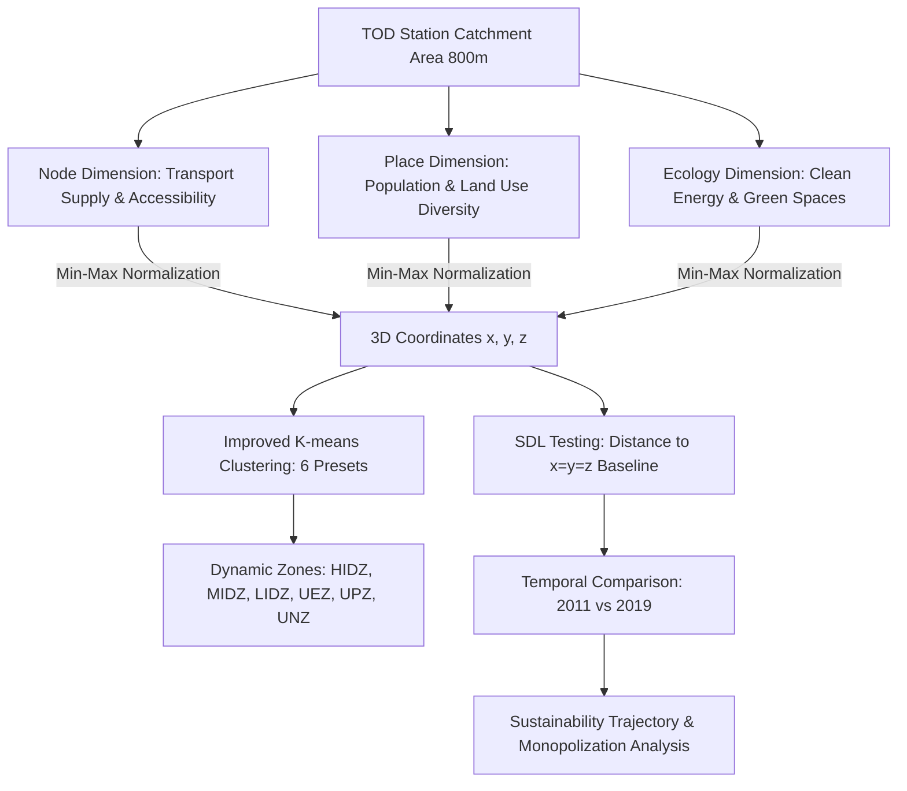

# Enhancing transit-oriented development sustainability through the integrated node-place-ecology (NPE) model

> [!summary] One-Sentence Summary
> This paper establishes a novel timeline-based Node-Place-Ecology (NPE) model combined with K-means clustering and Sustainable Development Line (SDL) testing to evaluate the 8-year longitudinal sustainability dynamics of 96 TOD station areas in the Tokyo Metropolitan Area, revealing overall positive sustainability trends alongside a growing central monopolization effect.

## 1. Basic Information

| Field | Content |
|---|---|
| Authors | Weiyao Yang, Qian Xu, Shengao Yi, Ravi Shankar, Tianyi Chen |
| Year | 2024 |
| Publication | Transportation Research Part D: Transport and Environment, Vol. 136, 104456 |
| DOI | 10.1016/j.trd.2024.104456 |
| Research Domain | [[Transit-Oriented Development]], [[Urban Ecology]], [[Sustainable Transportation]] |
| Research Type | Empirical Study / Methodological Framework Innovation |
| Research Object | Transit-Oriented Development (TOD) rail station catchment areas |
| Study Area | [[Tokyo Metropolitan Area]] (Odakyu Line & Tokyu Den-en-toshi Line) |
| Spatial Scale | Metropolitan scale; 800-meter Euclidean buffer catchment scale |
| Temporal Scope | 2011 and 2019 (longitudinal 8-year timeline comparison) |

## 2. Research Background and Questions

### 2.1 Research Background
Transit-Oriented Development (TOD) aims to foster compact, walkable communities around public transit hubs to improve urban sustainability and mitigate car dependency (PDF p. 1). Bertolini's classic 2D Node-Place (NP) model (1996, 1999) established a core analytical typology evaluating transit accessibility (Node) versus land-use intensity and diversity (Place) (PDF p. 3). However, conventional NP implementations suffer from critical static limitations, treating station catchment areas as unmoving snapshots and failing to account for temporal evolution over urban sprawl or shrinkage cycles (PDF pp. 1–3). Furthermore, existing 3D extensions (e.g., adding "Design", "Oriented", "Network", or "Tie" dimensions) focus predominantly on human travel behaviors and urban morphology, acting merely as "lubricants" between transit and land use rather than directly capturing ecological performance or low-carbon sustainability (PDF pp. 3–5).

### 2.2 Literature Gap
1. **Lack of Dynamic Longitudinal Frameworks**: Existing TOD typology models evaluate stations at a single static point in time, failing to track how station areas shift across typological boundaries as cities shrink or expand (PDF pp. 1, 5–6).
2. **Absence of Micro-Level TOD Ecological Evaluation**: While regional urban sustainability indicators exist, there is a lack of an integrated quantitative assessment model at the station micro-level that simultaneously balances transportation, land use, and ecosystem services (PDF p. 2).
3. **Rigid and Negative Typological Classifications**: Traditional models rely on rigid terms like "stress" and "dependency" zones, which impose static, negative judgments on stations that may actually be serving dynamic functional roles in megacity networks (PDF pp. 5–6).

### 2.3 Research Objectives and Questions
- **Research Objectives**: To construct a timeline-based Node-Place-Ecology (NPE) model incorporating K-means clustering and Sustainable Development Line (SDL) testing, and to empirically track the 8-year (2011–2019) sustainability trajectories of 96 rail transit station catchment areas in the Tokyo Metropolitan Area (PDF pp. 2, 6–7).
- **Research Questions**:
  1. How can an independent "Ecology" dimension be operationalized and integrated into the Node-Place framework to assess micro-level TOD sustainability?
  2. How did the 96 selected TOD stations in Tokyo evolve across Node, Place, and Ecology dimensions between 2011 and 2019?
  3. What spatial dynamics (e.g., central vs. suburban trends) govern the sustainability transitions of TOD station areas?
- **Hypotheses or Propositions**: The paper does not state explicit formal hypotheses but operates on the proposition that adding an Ecology dimension and a temporal SDL baseline enables a more dynamic and realistic evaluation of TOD sustainability trajectories (PDF pp. 6–10).

## 3. Theoretical and Conceptual Framework

### 3.1 Core Concepts

| Concept | Definition/Usage in Paper | Operationalization | Obsidian Link |
|---|---|---|---|
| Node-Place-Ecology (NPE) Model | A 3D analytical framework expanding the traditional 2D NP model by incorporating "Ecology" ($z$-axis) alongside "Node" ($y$-axis) and "Place" ($x$-axis) to evaluate TOD sustainability. | Operationalized using 18 min-max normalized indicators across transit, land use, new energy technology, and green space metrics. | [[Node-Place-Ecology Model]] |
| Sustainable Development Line (SDL) | A theoretical 3D diagonal line represented by $x=y=z$, where Node, Place, and Ecology values are in an ideal 1:1:1 ratio. | Defined as $x=y=z$ in 3D Cartesian space; used as the benchmark for absolute sustainability. | [[Sustainable Development Line]] |
| SDL Testing & SDL Value | A quantitative testing method measuring the Euclidean distance of a station's 3D coordinate $(x,y,z)$ to the SDL line. | $d_{\text{SDL}} = \sqrt{(x-s)^2 + (y-s)^2 + (z-s)^2}$ where $s = \frac{x+y+z}{3}$. Smaller value = higher sustainability. | [[Sustainable Development Line Testing]] |
| Dynamic Development Zones | Neutral dynamic typological zones replacing traditional static labels ("stress", "dependency") to reflect evolving urban function intensity. | Six predefined zones: High-intensity (HIDZ), Moderate-intensity (MIDZ), Low-intensity (LIDZ), Unsustained Ecology (UEZ), Unsustained Place (UPZ), Unsustained Node (UNZ). | [[TOD Typology]] |
| Central Monopolization Effect | The phenomenon where central metropolitan hub stations rapidly absorb developmental and ecological resource gains, compressing the relative indicator weights of peripheral/suburban stations. | Observed via longitudinal changes in min-max normalized indicator shares across central vs. suburban stations from 2011 to 2019. | [[Central Monopolization Effect]] |

### 3.2 Theoretical Foundations
The paper builds on three core theoretical frameworks:
1. **Bertolini's Node-Place Model (1996, 1999)**: Provides the fundamental dual-axis foundation balancing transport supply (Node) and land-use intensity/diversity (Place) (PDF p. 3).
2. **Urban Ecology & Eco-City Principles (Calthorpe, 1993; Cervero & Sullivan, 2011; Forman, 2016)**: Supplies the theoretical rationale for integrating ecosystem services, clean energy technologies, compact walkable layouts, and green infrastructure into transit planning (PDF p. 2).
3. **The Transit Metropolis Concept (Cervero, 1998)**: Explains the market-driven, rail-integrated real estate development model characteristic of private railways in Tokyo (PDF p. 7).

### 3.3 Conceptual Relationships

## 4. Data and Methodology

### 4.1 Research Design
The study adopts a **quantitative longitudinal empirical research design** combined with **methodological framework development**. It integrates GIS spatial calculations, Min-Max indicator normalization, an improved K-means clustering algorithm, and Sustainable Development Line (SDL) Euclidean distance testing across two baseline time points (2011 and 2019) (PDF pp. 6–10).

### 4.2 Data Overview

| Data/Sample | Source | Quantity & Time Period | Spatial Granularity | Purpose | Limitations |
|---|---|---|---|---|---|
| Transit Operational Data | Odakyu Line & Tokyu Railway station info | 96 railway stations (70 Odakyu, 27 Tokyu, 1 shared); 2011 & 2019 | Station point location | Measuring Node dimension indicators (N1, N2, N4) | Excludes non-rail transit operational frequency micro-changes |
| Passenger Flow & PTAL | National Land Numerical Info, NAVITIME, ESRI Japan | 96 station catchment areas; 2011 & 2019 | 800m Euclidean buffer around stations | Measuring Node accessibility (N3, N5, N6) | Euclidean buffer does not reflect actual pedestrian network barriers |
| Socio-Economic & Census Data | e-Stat (Japanese Official Statistics) | Grid-level census data; 2011 & 2019 | Census block grid aggregated to 800m buffer | Measuring Place dimension indicators (P1–P6) | Temporal lag between census years and target baseline years |
| Ecological & Green Space Data | Ministry of the Environment (REPOS), Fundamental Mapping Info, Google Maps | Green space, solar potential, solar panels; 2011 & 2019 | 800m buffer polygons | Measuring Ecology indicators (E2, E4, E6) | Solar potential is estimated via formulas rather than direct micro-metering |
| EV & Building Energy Data | EV Smart, NEV Japan, BEMA | EV chargers, EV stock, building energy consumption; 2011 & 2019 | Station catchment buffer | Measuring Ecology technology indicators (E1, E3, E5) | E5 building energy consumption is an estimated proxy value |

### 4.3 Methodological Workflow
1. **Catchment Delineation & Indicator Construction**: Delineate an 800-meter Euclidean buffer for all 96 stations. Construct 18 quantitative indicators across Node (6), Place (6), and Ecology (6) dimensions based on literature and a 12-expert panel review (PDF pp. 7–9).
2. **Data Standardization**: Normalize all raw indicator values to a $[0, 1]$ scale using Min-Max Normalization to ensure dimensional consistency across 2011 and 2019 datasets (PDF p. 9).
3. **Improved K-means Clustering**: Execute K-means clustering with $K=6$ clusters fixed to initial physical centroids in 3D coordinate space: HIDZ (1,1,1), MIDZ (0.5,0.5,0.5), LIDZ (0,0,0), UPZ (1,0,0), UEZ (0,1,0), and UNZ (0,0,1) (PDF pp. 9–10).
4. **SDL Testing & Distance Calculation**: Calculate the Euclidean distance ($d_{\text{SDL}}$) from each station's 3D coordinates $(x,y,z)$ to the Sustainable Development Line ($x=y=z$) for 2011 and 2019. Calculate the SDL difference value ($\Delta \text{SDL} = \text{SDL}_{2011} - \text{SDL}_{2019}$) to evaluate longitudinal trajectory (PDF p. 10).

### 4.4 Models, Metrics, and Variables

| Metric Name | Type | Definition or Calculation Method | Role in Study |
|---|---|---|---|
| N1–N6 | Transit Indicators | Metro directions (N1), daily service frequency (N2), passenger volume (N3), service type (N4), bus directions (N5), PTAL index (N6). | Operationalizing Node dimension ($y$-axis). |
| P1–P6 | Development Indicators | Resident population (P1), job volume (P2), retail/catering jobs (P3), education/health jobs (P4), admin/service jobs (P5), industrial jobs (P6). | Operationalizing Place dimension ($x$-axis). |
| E1–E6 | Ecological Indicators | Public EV chargers (E1), solar potential (E2), EV vehicle stock (E3), open green space area (E4), building energy consumption (E5, negative metric), Walk Score (E6). | Operationalizing Ecology dimension ($z$-axis). |
| SDL Equation | Reference Line | $x = y = z$ in 3D Cartesian normalized space. | Baseline benchmark for perfect dimensional balance. |
| SDL Euclidean Distance ($d_{\text{SDL}}$) | Evaluation Metric | $d_{\text{SDL}} = \sqrt{(x-s)^2 + (y-s)^2 + (z-s)^2}$ where $s = \frac{x+y+z}{3}$. | Quantifying degree of un-sustainability (distance to equilibrium). |
| SDL Difference Value ($\Delta \text{SDL}$) | Longitudinal Trajectory Metric | $\Delta \text{SDL} = \text{SDL}_{2011} - \text{SDL}_{2019}$. $\Delta \text{SDL} > 0$ indicates positive sustainability progress. | Determining temporal direction of TOD evolution. |

**Key Mathematical Formulas**:
$$\text{Min-Max Normalization}: X_{\text{norm}} = \frac{X - X_{\min}}{X_{\max} - X_{\min}}$$
$$\text{SDL Distance}: d_{\text{SDL}} = \sqrt{(x - s)^2 + (y - s)^2 + (z - s)^2}, \quad \text{where } s = \frac{x + y + z}{3}$$
$$\text{SDL Trajectory Difference}: \Delta \text{SDL} = \text{SDL}_{2011} - \text{SDL}_{2019}$$

### 4.5 Methodological Evaluation
- **Methodological Soundness**: Fixing the initial centroids of K-means to 6 predefined domain-specific coordinate points directly resolves the classic initial centroid sensitivity and arbitrary cluster count issues of standard K-means (PDF p. 10).
- **Improvements over Existing Methods**: Replaces rigid 2D diagonals with a 3D line baseline ($x=y=z$) and replaces static negative labels ("stress") with dynamic development intensity zones (HIDZ, MIDZ, LIDZ) (PDF pp. 6, 10).
- **Potential Biases & Validity Risks**: Using global Min-Max normalization across all 96 stations creates a zero-sum relative weighting dynamic. Extreme progress at central mega-hubs (Shinjuku/Shibuya) automatically reduces the normalized scores of suburban stations even if suburban absolute values remain constant or improve (PDF pp. 13, 17) *(Analytical Synthesis)*.
- **Reproducibility Information Requirements**: Detailed GIS overlay scripts and exact building energy consumption proxy calculation formulas (E5) are mentioned but full code scripts are not attached (PDF p. 9).

## 5. Main Findings

### 5.1 Core Findings

1. **Overall Metropolitan TOD Progress Toward Sustainability**: Across the 8-year period (2011–2019), the overall average SDL distance for all 96 stations decreased from 0.2865 to 0.2241 ($\Delta \text{SDL} = +0.0624$), proving that the Tokyo TOD network as a whole progressed toward greater sustainability (PDF p. 11, Table 4).
2. **Substantial Reduction in Unsustained Ecology Zone (UEZ) Stations**: Stations categorized under the Unsustained Ecology Zone (UEZ) dropped sharply from 28 in 2011 to 15 in 2019. Fifteen stations transitioned directly from UEZ to LIDZ, and three transitioned from UEZ to MIDZ (PDF p. 11, Table 3, Table 7).
3. **Identification of Central Monopolization Effect**: Central mega-hub stations (Shinjuku and Shibuya) achieved rapid progress across all three dimensions, particularly in Ecology (e.g., Shinjuku's SDL distance improved from 0.5448 to 0.4051; Shibuya improved from 0.3244 to 0.2159). This extreme concentration of ecological and development gains at central hubs compressed the relative normalized ecological weights of suburban stations (PDF pp. 14–16, Table 6).
4. **Drivers of UEZ-to-LIDZ Transitions**: The primary mathematical driver behind the shift of 15 stations from UEZ to LIDZ was not a dramatic increase in their own local Node or Place values, but rather a relative reduction in their normalized ecological share caused by central hub ecological surges (PDF pp. 13–14, Table 5).
5. **Private Railway Corridor Divergence (Tokyu Den-en-toshi Line Success)**: By 2019, zero stations on the Tokyu Den-en-toshi Line remained in unsustainable zones (UEZ, UPZ, UNZ). All 27 Tokyu stations achieved sustainable zone statuses (LIDZ, MIDZ, or HIDZ), reflecting effective proactive rail-land-environment management by Tokyu Corporation (PDF p. 11, Fig. 6b).

### 5.2 Secondary Findings and Anomalies
- **Zero Unsustained Node/Place Zones**: In both 2011 and 2019, zero stations fell into the Unsustained Node Zone (UNZ) or Unsustained Place Zone (UPZ) (PDF p. 11, Table 3). This highlights that Tokyo's rail transit development is deeply integrated with land-use development, preventing severe Node-Place disconnects *(Analytical Synthesis)*.
- **Slight Negative Trajectory in LIDZ Group**: While the overall network improved, the average SDL distance for the LIDZ cluster slightly deteriorated from 0.1802 in 2011 to 0.1866 in 2019 ($\Delta \text{SDL} = -0.0064$) due to the influx of former UEZ stations whose relative ecological scores dropped (PDF p. 11, Table 4).

### 5.3 Research Questions and Results Mapping

| Research Question / Thesis | Corresponding Result | Supported? | Evidence Location |
|---|---|---|---|
| Q1: How to operationalize an Ecology dimension in TOD? | Constructed 6 ecological metrics (E1–E6) combining EV, solar, green space, energy, and walkability. | Supported | PDF pp. 8–9, Table 2 |
| Q2: Did Tokyo TOD stations move toward sustainability between 2011 and 2019? | Average SDL distance decreased from 0.2865 to 0.2241 ($\Delta \text{SDL} = +0.0624$). | Supported | PDF p. 11, Table 4 |
| Q3: What spatial patterns govern typological shifts? | UEZ stations dropped from 28 to 15; Central hubs (Shinjuku/Shibuya) exhibited strong monopolization. | Supported | PDF pp. 11–16, Fig. 5–8 |

## 6. Discussion and Contributions

### 6.1 Theoretical Contributions
- **Extension of TOD Typology Theory**: Successfully moves TOD typology from a 2D plane (Node-Place) or 3D behavior-centric model (Node-Place-Design) to a 3D holistic sustainability model (Node-Place-Ecology) (PDF pp. 3–5).
- **Reframing Dynamic Typology Terminology**: Replaces static, value-laden terms ("stress", "dependency") with neutral intensity descriptors (HIDZ, MIDZ, LIDZ), establishing a conceptual framework suitable for dynamic cities undergoing expansion or shrinkage (PDF pp. 5–6).

### 6.2 Methodological Contributions
- **Creation of SDL Testing Protocol**: Formulates the Sustainable Development Line ($x=y=z$) and Euclidean distance testing as an explicit quantitative benchmark to evaluate multi-dimensional equilibrium (PDF p. 10).
- **Centroid-Guided K-means Optimization**: Overcomes traditional K-means initialization bias by locking initial cluster centroids to 6 domain-defined physical coordinates (PDF p. 10).

### 6.3 Empirical Contributions
- **Longitudinal Dataset of Tokyo TOD Network**: Provides an 8-year granular dataset spanning 96 station areas across private railway corridors in the Tokyo Metropolitan Area (PDF pp. 7–9).
- **Empirical Uncovering of Monopolization Risk**: Documents how central mega-hubs monopolize ecological and developmental resources under megacity management plans (PDF pp. 14–17).

### 6.4 Practical and Policy Implications
- **Avoiding False Policy Optimism**: Policy makers must recognize that a suburban station shifting into a "balanced" LIDZ zone might reflect relative ecological compression driven by central hub monopolization rather than true local transit/land-use progress (PDF pp. 16–17).
- **Targeted Station Area Governance**:
  - *UEZ Stations*: Focus policy support on enhancing transit accessibility (Node) and land-use diversity (Place) to activate existing ecological assets.
  - *LIDZ/MIDZ Stations*: Continuously monitor local metric balances to prevent subtle environmental degradation.

## 7. Limitations and Future Research

### 7.1 Author-Acknowledged Limitations
1. **Geographic Scope Constraint**: The empirical analysis is strictly confined to 96 stations along two private rail corridors in Tokyo, limiting direct generalizability to cities with different institutional or urban layouts (PDF pp. 17–18).
2. **Lack of In-Depth Micro-Level Metric Attribution**: The study struggles to isolate exactly how much of a station's individual score shift was caused by its own micro-level investments versus external relative shifts across the 18 indicators (PDF p. 17).
3. **Idealized SDL Assumption**: The $x=y=z$ diagonal represents an idealized equal-weight state, which may carry theoretical uncertainty in non-linear urban environments (PDF p. 18).

### 7.2 Further Identified Limitations *(Analytical Synthesis)*
- **Euclidean Buffer Distortions**: Using an 800-meter Euclidean radius ignores topological walking barriers (e.g., highways, rivers, railway tracks), which can artificially distort actual catchment area accessibility.
- **Min-Max Normalization Zero-Sum Vulnerability**: Global normalization across time points couples peripheral station evaluations directly to central hub performance, masking absolute local ecological improvements in suburban areas.

### 7.3 Future Research Directions
- **Author Suggestions**: Extend the NPE model to diverse global metropolitan areas; develop non-linear quantitative boundary thresholds (e.g., "olive-shaped" 3D confidence regions around SDL) (PDF p. 18).
- **Analytical Suggestions**: Integrate actual network pedestrian sheds (isochrones) instead of Euclidean buffers, and incorporate local un-normalized longitudinal tracking alongside global normalized scoring *(Analytical Synthesis)*.

## 8. Key Evidence and Quotations

| Purpose | Quote or Accurate Paraphrase | Page | Usage Reminder |
|---|---|---|---|
| Model Definition | "This study seeks to bridge these gaps by presenting a novel, timeline-based node-place-ecology (NPE) model, integrating K-means clustering and Sustainable Development Line (SDL) testing..." | PDF p. 1 | Quote for defining NPE model innovation |
| Core Finding | Average SDL distance decreased from 0.2865 in 2011 to 0.2241 in 2019, showing an overall positive trajectory toward TOD sustainability across Tokyo. | PDF p. 11 | Paraphrase of main quantitative finding |
| Monopolization Finding | "Additionally, we observed an increasing trend of monopolization in the node, place, and ecology dimensions at the stations located in the metropolitan center." | PDF p. 1 | Direct quote for policy critique |
| SDL Concept | The Sustainable Development Line (SDL) is defined by $x=y=z$ in 3D normalized space, representing equal proportional performance across Node, Place, and Ecology dimensions. | PDF p. 10 | Paraphrase of theoretical baseline |

## 9. Relevance to My Research Subject

**User's Research Topic**: *What are the key environmental and structural limitations of Hong Kong’s traditional "Rail plus Property" (R+P) TOD framework when deployed in ecologically sensitive wetland ecosystems in the Northern Metropolis?*

### Analytical Insights & Direct Applications *(Analytical Synthesis)*:
1. **Structural Limitation of R+P (Over-Maximizing Node & Place at Ecology's Expense)**: Hong Kong's traditional R+P framework operates on a financial self-sufficiency model, driving maximum real estate plot ratios (Place) and transit throughput (Node) around station nodes. Applying Yang et al.'s NPE framework highlights that deploying traditional R+P in the Northern Metropolis wetlands risks creating severe **Unsustained Place Zones (UPZ)** or **Unsustained Node Zones (UNZ)**, where intensive land construction dismantles critical ecological buffer functions (wetlands, fish ponds, migratory bird corridors).
2. **Methodological Transferability (Integrating Ecology into R+P Evaluation)**: The NPE model's primary contribution—inserting an explicit $z$-axis ("Ecology") alongside Node and Place—provides a direct methodological template for Hong Kong planners. Instead of evaluating R+P proposals solely on financial returns and transit ridership, HK planners can adopt a 3D R+P+E matrix incorporating wetland habitat connectivity, ecological footprint, building energy intensity, and green infrastructure metrics.
3. **The "Monopolization & Relative Distortion" Warning**: The paper's finding regarding central monopolization serves as a vital warning for Hong Kong's regional spatial strategy. If megaprojects in urban core hubs (e.g., Kau Yi Chau Artificial Islands or Central) concentrate green building certifications and high-tech energy investments, regional normalized models might mask ecological degradation occurring in peripheral wetland stations (e.g., San Tin Technopole, Kwu Tung North, Lok Ma Chau).
4. **SDL Benchmark as a Governance Tool**: The Sustainable Development Line ($x=y=z$) can be adapted into a policy constraint tool for the Northern Metropolis, stipulating that R+P developments in ecologically sensitive areas must not proceed unless the Ecology score matches or exceeds the Node and Place intensity scores.

## 10. Literature Network

### 10.1 Strongly Related Literature

| Related Paper | Relation Type | Relation Explanation | Basis | Confidence | Note Status |
|---|---|---|---|---|---|
| [[Bertolini_1999_Spatial_Development_Patterns]] | Theoretical Foundation | Provides the baseline 2D Node-Place model, coordinate logic, and diagonal equilibrium concept. | PDF pp. 3, 5–6 | High | To be created |
| [[Yang_2024_Node_Place_Ecology_Odawara]] | Extension | Precursor study that first introduced the Ecology dimension in Odawara; current paper extends it to dynamic timelines and central-suburban scales. | PDF pp. 4, 5, 6 | High | To be created |
| [[Vale_2018_Node_Place_Design]] | Extension / Methodological | Extended NP model into Node-Place-Design (NPD) and proposed replacing "stress/dependency" with "urban/future TOD". | PDF pp. 3, 4, 6 | High | To be created |
| [[Lyu_2016_Node_Place_Oriented]] | Methodological | Pioneer in expanding NP to 3D spatial model ("Oriented" dimension) in Beijing. | PDF pp. 3, 4, 5 | High | To be created |
| [[Chorus_2011_Node_Place_Tokyo]] | Empirical / Case | Applied traditional NP model to train station areas in Tokyo. | PDF p. 2 | Medium | To be created |
| [[Cervero_2011_Green_TODs]] | Theoretical Foundation | Concept of "Green TODs" combining transit development with green urbanism and low-carbon tech. | PDF p. 2 | High | To be created |

### 10.2 Concept, Method, and Case Nodes

| Node | Type | Role in Paper | Suggested Connection Direction |
|---|---|---|---|
| [[Node-Place-Ecology Model]] | Concept / Method | Central 3D framework developed in paper | Connect to TOD evaluation, dynamic modeling |
| [[Sustainable Development Line]] | Method | 3D diagonal benchmark ($x=y=z$) for equilibrium | Connect to multi-criteria decision making, sustainability baselines |
| [[TOD Typology]] | Concept | Typological classification system for station areas | Connect to transit planning, urban structure |
| [[Central Monopolization Effect]] | Concept | Observed dynamic where mega-hubs dominate relative metric gains | Connect to regional disparity, urban hierarchy, shrinkage |
| [[Tokyo Metropolitan Area]] | Area | Case study region encompassing 96 stations | Connect to megacity transit studies, private railway TOD |
| [[K-Means Clustering]] | Method | Machine learning algorithm used for station classification | Connect to spatial statistics, typology methods |
| [[Rail plus Property]] | Concept | Transit finance & land development framework | Connect to Hong Kong urban planning, Northern Metropolis |

### 10.3 Network Summary
This paper sits at the intersection of **TOD Typology Modeling** and **Urban Ecological Assessment**. It directly inherits Bertolini's (1996, 1999) dual-axis spatial framework, extends the 3D expansion branch initiated by Lyu et al. (2016) and Vale et al. (2018), and builds upon Yang et al. (2024). It introduces two key innovations to the literature network: (1) operationalizing an independent Ecology dimension ($z$-axis) capturing clean energy and walkability, and (2) establishing a timeline-based SDL testing method that uncovers central monopolization dynamics in megacities. *(Note: Relationships established based on paper references and semantic content).*

## 11. Post-Reading Research Memo

> [!question] Worthwhile Questions for Further Inquiry
> 1. How can absolute ecological thresholds (e.g., wetland biodiversity indices, ecological flow) be integrated into the NPE model to prevent relative normalization from masking peripheral ecosystem degradation?
> 2. How would the NPE model results change if pedestrian network catchment areas (isochrones) were used instead of an 800-meter Euclidean buffer?
> 3. How can Hong Kong's "Rail plus Property" financial development formula be re-engineered to incorporate the $x=y=z$ SDL equilibrium constraint in the Northern Metropolis?

> [!idea] Transferable Methods and Ideas
> - **3D Coordinate Equilibrium Testing**: The SDL testing method ($d_{\text{SDL}}$ distance to $x=y=z$) can be transferred to evaluate multi-objective urban planning trade-offs (e.g., balancing economic growth, social equity, and environmental protection).
> - **Centroid-Locked K-Means**: Fixing K-means initial centroids to physical domain bounds provides a clean, reproducible spatial classification method for urban studies.

> [!warning] Limitations When Applying Findings
> - **Normalization Dependency**: Normalized scores are highly sensitive to sample composition. Adding or removing central hub stations drastically alters peripheral scores.
> - **Institutional Context Boundaries**: Tokyo's TOD success is driven by private railway competition and market real estate; findings cannot be applied directly to state-funded or strictly regulated transit systems without institutional adjustments.

## 12. Reference Clues

| Suggested Note Link | Recommendation Reason | Relationship to Paper | Priority |
|---|---|---|---|
| [[Bertolini_1999_Spatial_Development_Patterns]] | Foundational text defining the Node-Place model and coordinate logic. | Theoretical Foundation | High |
| [[Yang_2024_Node_Place_Ecology_Odawara]] | Precursor article establishing the initial NPE indicator set in Odawara. | Precursor / Method Source | High |
| [[Vale_2018_Node_Place_Design]] | Key 3D expansion paper introducing walkability and dynamic typology naming. | Method / Typology Source | High |
| [[Lyu_2016_Node_Place_Oriented]] | First paper to formalize 3D spatial node-place modeling ("T-O-D"). | Method Origin | Medium |
| [[Cervero_2011_Green_TODs]] | Definitive paper on marrying TOD with low-carbon green urbanism. | Theoretical Foundation | High |
| [[Chorus_2011_Node_Place_Tokyo]] | Benchmark study applying classic NP model specifically to Tokyo station areas. | Case Baseline | Medium |
| [[Ke_2021_Environmental_Economic_Social_Transit_Efficiency]] | Micro-level TOD sustainability study on 13 Tokyo stations. | Indicator Source | Medium |

## 13. Concise Summary

- **One-Sentence Question**: How can TOD sustainability be dynamically evaluated across transportation, land use, and ecological dimensions over time?
- **One-Sentence Method**: Constructs a 3D Node-Place-Ecology (NPE) model combining min-max normalization, centroid-locked K-means clustering, and Sustainable Development Line (SDL) Euclidean distance testing across 2011 and 2019 data for 96 Tokyo stations.
- **One-Sentence Finding**: Tokyo's TOD network generally progressed toward sustainability over 8 years ($\Delta \text{SDL} = +0.0624$), but central mega-hubs (Shinjuku/Shibuya) exhibited a strong central monopolization effect that compressed peripheral ecological score shares.
- **One-Sentence Contribution**: Fuses dynamic temporal analysis and micro-level urban ecology into TOD typology theory, offering a robust quantitative framework for longitudinal urban planning evaluation.
- **One-Sentence Limitation**: Dependent on relative global indicator normalization and Euclidean catchment buffers, which can distort micro-level peripheral ecological shifts.
- **Worth Reading Intensely?**: **Yes** — Highly valuable for methodological framework design and spatial sustainability metrics.
- **Recommendation Priority**: ★★★★★